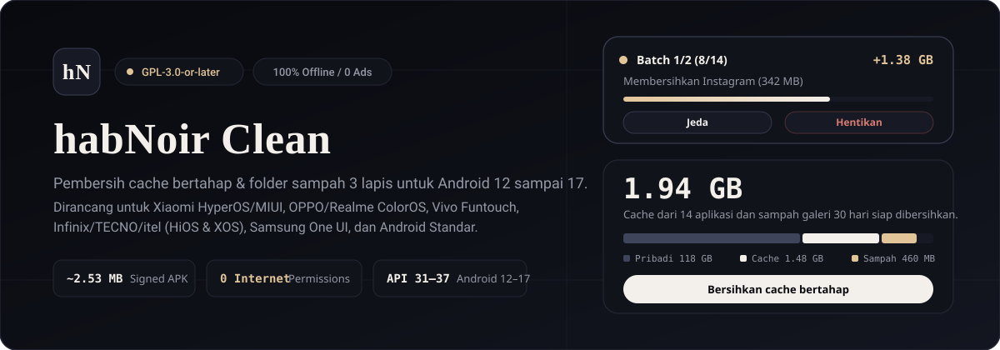
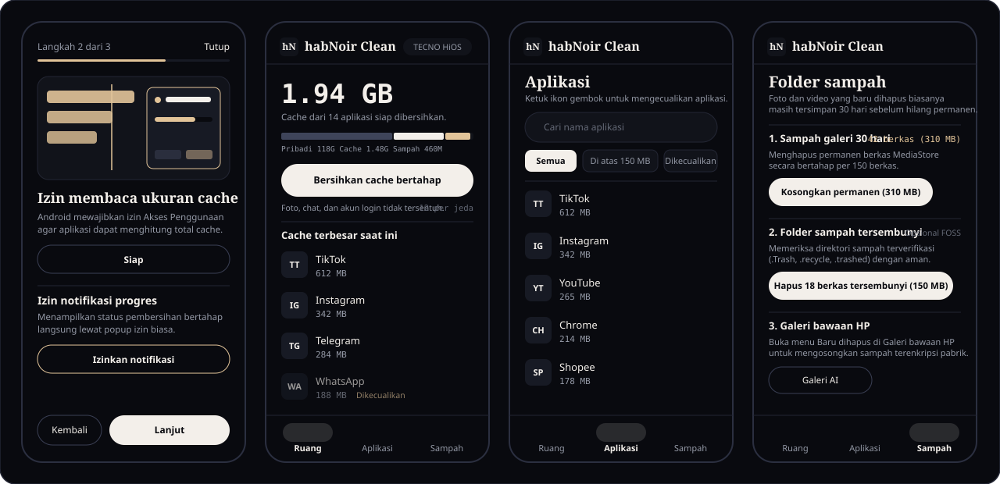

<div align="center">


# habNoir Clean

**Pembersih Cache Bertahap & Folder Sampah 3 Lapis untuk Android 12 sampai 17**

[](./LICENSE)
[-F3EFEA?style=flat-square&labelColor=11131A)](./app/build.gradle.kts)
[](https://github.com/habNoir/habNoir-Clean/releases/latest)
[](./app/src/main/AndroidManifest.xml)

<br />



</div>

---

## Ringkasan

**habNoir Clean** (`xyz.habnoir.clean`) adalah aplikasi pembersih cache aplikasi dan berkas sampah Android bersumber terbuka (**GPL-3.0-or-later**) yang dirancang agar ringan (**~2.56 MB**), bebas iklan, bebas pelacak, dan berjalan **100% offline** tanpa izin `INTERNET` maupun `ACCESS_NETWORK_STATE`.

Aplikasi ini dibangun khusus untuk menangani kustomisasi antarmuka ponsel yang banyak digunakan di Indonesia (**Xiaomi/Redmi/POCO HyperOS & MIUI**, **OPPO/Realme/OnePlus ColorOS**, **Vivo/iQOO Funtouch OS**, **Infinix/TECNO/itel XOS & HiOS**, **Samsung One UI**, serta **Android Standar / AOSP**) pada **Android 12 (API 31) hingga Android 17 (API 37)**.

---

## Tampilan Antarmuka

<div align="center">
  
</div>

1. **Wizard Interaktif 3 Langkah & Ilustrasi Vektor Animasi:** Dilengkapi kanvas ilustrasi vektor teranimasi (Vault pelindung data pribadi, pemindai telemetri penyimpanan, serta panduan buka kunci *Setelan Terbatas* Android 13–17) dan tombol popup 1-tap untuk izin notifikasi progres.
2. **Tab Ruang (`HomeScreen`) & Mini-Window Mengambang:** Menampilkan total ruang yang siap dilegakan, *Storage Strata Bar* 3 segmen (*Pribadi*, *Cache*, *Sampah*), daftar aplikasi dengan cache terbesar, serta jendela mengambang (*Floating Mini-Window*) real-time di bagian atas layar dengan tombol **Jeda / Lanjutkan** dan **Hentikan** seketika saat pembersihan berjalan.
3. **Tab Aplikasi (`AppsScreen`):** Pencarian aplikasi instan, filter cepat (*Semua*, *Di atas 150 MB*, *Dikecualikan*), dan tombol gembok 1-tap untuk mengecualikan aplikasi tertentu dari antrean pembersihan.
4. **Tab Folder Sampah 3 Lapis (`TrashScreen`):**
   - **Lapis 1 (Sampah Galeri 30 Hari):** Menghapus permanen berkas berstatus `MediaStore.MediaColumns.IS_TRASHED = 1` secara bertahap per 150 berkas melalui dialog konfirmasi resmi Android (`MediaStore.createDeleteRequest`).
   - **Lapis 2 (Folder Sampah Tersembunyi OEM — Opsional FOSS):** Memindai secara deterministik hanya direktori sampah terverifikasi (`.Trash`, `.recycle`, `.vivo_recycle`, `MIUI/Gallery/cloud/.trashBin`, `.ColorOS/.recycle`, `.HiOS_Trash`, `.XOS_Trash`, dan berkas yatim `.trashed-*`) tanpa pernah menyentuh folder foto kamera (`DCIM/Camera`) atau media chat aktif.
   - **Lapis 3 (Pintasan Galeri Bawaan HP):** Membuka langsung aplikasi galeri bawaan pabrik untuk mengosongkan album *Baru Dihapus* yang dienkripsi khusus oleh OEM.

---

## Fitur Keamanan & Keunggulan Teknis

### 1. Pembersihan Bertahap Adaptif (`StagedCleanOrchestrator` & `DeviceHealthMonitor`)
Untuk mencegah ponsel *freeze*, panas berlebih, atau menutup aplikasi secara paksa, antrean pembersihan dibagi otomatis ke dalam *batch* berdasarkan kapasitas RAM dan sensor termal perangkat (`PowerManager.getCurrentThermalStatus()`):

| Profil Perangkat | Ukuran Batch | Jeda Antar Aplikasi | Jeda Pendinginan Antar Batch |
| :--- | :---: | :---: | :---: |
| **RAM Rendah (`< 4 GB`)** | `5` aplikasi | `650 ms` | `3.5 detik` |
| **Mid-Range (`4 – 6 GB`)** | `8` aplikasi | `450 ms` | `2.5 detik` |
| **Flagship (`> 6 GB`)** | `12` aplikasi | `300 ms` | `1.5 detik` |
| **Thermal Guard (`MODERATE+`)** | `3` aplikasi | `900 ms` | `5.0 detik` |

### 2. Penjaga Anti-Hapus-Data (`SafetyNodeMatcher` & `SystemProcessGuard`)
- **Blokir Kata Kunci Berbahaya:** Menolak secara keras node UI apa pun yang mengandung kata kunci penghapusan data pengguna (`Hapus data`, `Hapus penyimpanan`, `Hapus semua data`, `Clear data`, `Clear storage`, `Manage space`, `Uninstall`, `Force stop`, `Reset`).
- **Penanganan Bottom-Sheet Xiaomi HyperOS / MIUI:** Ketika tombol *Hapus data* pada Xiaomi membuka *bottom-sheet* dua opsi (*Bersihkan semua data* vs *Bersihkan cache*), asisten hanya mengetuk opsi **Bersihkan cache** secara eksak dan langsung membatalkan proses bila dialog konfirmasi penghapusan data terdeteksi.
- **Perlindungan Layanan Inti Sistem:** Mengecualikan proses krusial (`com.google.android.gms`, `com.google.android.gsf`, `com.android.systemui`, dan paket sistem inti) agar sesi pembersihan tidak memicu layar pengelolaan data kustom.

### 3. Kompatibilitas OEM Indonesia (`OemSpecRegistry`)
Mendukung deteksi otomatis merek perangkat, versi antarmuka, pencocokan label multibahasa (Indonesia & Inggris), serta *view ID* spesifik pabrik:

| Keluarga OEM | Antarmuka | Target Tombol Utama |
| :--- | :--- | :--- |
| **Xiaomi / Redmi / POCO** | HyperOS & MIUI | `Bersihkan cache` / `Clear cache` (Bottom-Sheet & Direct) |
| **OPPO / Realme / OnePlus** | ColorOS & Realme UI | `Hapus cache` / `Clear cache` |
| **Vivo / iQOO** | Funtouch OS & OriginOS | `Hapus cache` / `Bersihkan cache` / `Clear cache` |
| **Infinix / TECNO / itel** | XOS & HiOS | `Hapus cache` / `Clear cache` |
| **Samsung** | One UI | `Hapus memori` / `Hapus cache` / `Clear cache` |
| **Google / Asus / Motorola / AOSP** | Android Standar | `Hapus cache` / `Clear cache` |

---

## Varian Distribusi & Verifikasi Rilis (`v1.0.1`)

Proyek ini menyediakan dua *product flavor* yang telah melalui optimasi penuh **R8 Full Mode**, menghapus izin berisiko tinggi `QUERY_ALL_PACKAGES` (diganti filter `<queries>` standar Android 11+ agar ramah terhadap heuristik Google Play Protect), dan ditandatangani dengan skema **APK Signature Scheme v3 (RSA 4096-bit)**:

| Berkas APK | Ukuran | SHA-256 | Keterangan |
| :--- | :---: | :--- | :--- |
| `habNoir-Clean-v1.0.1-foss-release.apk` | `2.56 MB` (`2,685,606 B`) | `1c77cd6fd719bfd30d005d0fc708f364de19c15678e53ca05a9110f0a4e68e44` | Edisi lengkap (GitHub / F-Droid / IzzyOnDroid) dengan dukungan Lapis 2 folder sampah tersembunyi & popup 1-tap optimasi baterai |
| `habNoir-Clean-v1.0.1-store-release.apk` | `2.56 MB` (`2,685,529 B`) | `44265aef3d25143a053d170d5e3d293d73c8db439b60ecc3f4158f0e08053b55` | Edisi ringan tanpa izin `MANAGE_EXTERNAL_STORAGE` & `REQUEST_IGNORE_BATTERY_OPTIMIZATIONS` (paling ramah Play Protect) |

**Sertifikat Penandatangan (`apksigner verify --print-certs`):**
- **DN:** `CN=habNoir, OU=Mobile, O=habNoir, L=Jakarta, ST=DKI Jakarta, C=ID`
- **Certificate SHA-256:** `45ab5668d831ab317be202a3a2acb6692a72a9da66e9ab4d889de7ae95bae68b`

**Verifikasi Nol Izin Internet & Tanpa `QUERY_ALL_PACKAGES` (`aapt2 dump permissions`):**
```text
package: xyz.habnoir.clean
uses-permission: name='android.permission.MANAGE_EXTERNAL_STORAGE'
uses-permission: name='android.permission.REQUEST_IGNORE_BATTERY_OPTIMIZATIONS'
uses-permission: name='android.permission.PACKAGE_USAGE_STATS'
uses-permission: name='android.permission.FOREGROUND_SERVICE'
uses-permission: name='android.permission.FOREGROUND_SERVICE_SPECIAL_USE'
uses-permission: name='android.permission.POST_NOTIFICATIONS'
```

### Panduan Membuka Kunci Setelan Terbatas (Android 13 – 17)
Ketika memasang APK langsung dari browser atau pengelola berkas (*sideload*), sistem keamanan Android 13–17 mengunci **Akses Penggunaan** dan **Aksesibilitas** di balik **Setelan Terbatas** (*Restricted Settings*). Cara membukanya cukup **1 kali** untuk kedua izin sekaligus:
1. Ketuk opsi **Akses Penggunaan** atau **Aksesibilitas** yang terkunci sebanyak 1 kali hingga muncul dialog peringatan *Setelan Terbatas*, lalu ketuk **Oke**.
2. Di dalam Wizard Langkah 2/3 atau menu Setelan aplikasi, ketuk tombol **1. Buka Info Aplikasi (Izinkan setelan terbatas)**.
3. Ketuk ikon **titik tiga (`⋮`)** di pojok kanan atas halaman Info Aplikasi, pilih **Izinkan setelan terbatas** (*Allow restricted settings*), lalu verifikasi sidik jari atau PIN ponsel Anda.
4. Setelah dibuka 1 kali, baik **Akses Penggunaan** maupun **Asisten Aksesibilitas** dapat langsung diaktifkan.

---

## Cara Membangun dari Kode Sumber

Prasyarat: **JDK 17+** dan **Android SDK (`compileSdk = 37`)**.

```bash
# 1. Jalankan seluruh unit test JVM (22 test di 6 test suite)
./gradlew testFossDebugUnitTest

# 2. Jalankan pemeriksaan Android Lint
./gradlew lintFossDebug

# 3. Bangun APK rilis FOSS dan Store
./gradlew assembleFossRelease assembleStoreRelease
```

Untuk menandatangani APK rilis secara otomatis saat *build*, buat berkas `keystore.properties` di direktori akar proyek (tidak dilacak oleh Git):

```properties
storeFile=keystore/habnoir-release.jks
storePassword=KATA_SANDI_KEYSTORE
keyAlias=habnoir_release
keyPassword=KATA_SANDI_KEY
```

---

## Dokumentasi Arsitektur

- [Product Requirements Document (PRD)](./docs/PRD.md)
- [Technical Design Document (TDD)](./docs/TDD.md)
- [UI/UX Design Specification](./docs/UI_UX_DESIGN.md)
- [Implementation Plan](./docs/IMPLEMENTATION_PLAN.md)

---

## Lisensi

Hak Cipta (C) 2026 **habNoir**. Dirilis di bawah lisensi [GNU General Public License v3.0 or later (GPL-3.0-or-later)](./LICENSE).
Tipografi judul menggunakan font terbuka **Cinzel** di bawah lisensi [SIL Open Font License 1.1](./THIRD_PARTY_LICENSES/CINZEL-OFL.txt).
