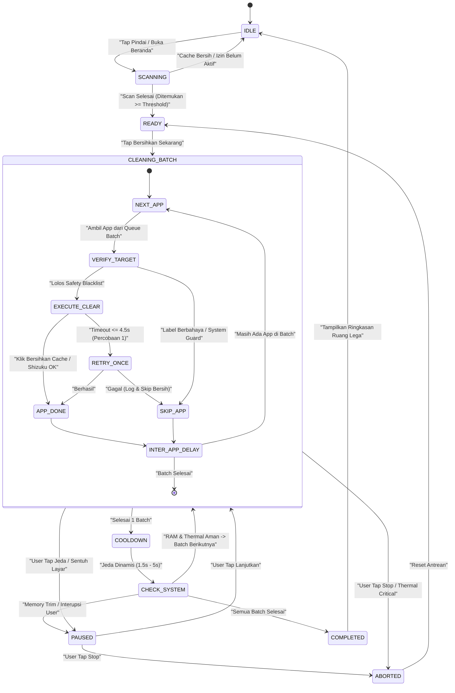

# Product Requirements Document (PRD) — habNoir Clean

> **Dokumen:** PRD-001 · **Versi:** 1.0.0 · **Status:** Draft Siap Eksekusi  
> **Tanggal:** 21 November 2026 · **Target Platform:** Android 12 (API 31) – Android 17 (API 37)  
> **Bahasa Produk:** Bahasa Indonesia (Utama) & English (Fallback)  
> **Identitas Visual:** habNoir UI (diadaptasi dari [Porto](file:///c:/Users/Administrator/Documents/Coding%20Project/Porto))

---

## 1. Ringkasan Eksekutif & Identitas Produk

### 1.1 Nama & Visi Produk
**habNoir Clean** *(nama kerja; dapat difinalisasi sebelum rilis v1.0)* adalah aplikasi utilitas Android **100% open-source, ultra-ringan, bebas iklan, dan 100% offline** untuk membersihkan **cache seluruh aplikasi secara bertahap (1-klik)** serta mengosongkan **folder sampah (*trash* / *recycle bin*)** yang menumpuk di perangkat Android.

Aplikasi ini dirancang secara khusus dengan pendekatan empatik bagi **pengguna kasual di Indonesia—terutama perempuan, pelajar, dan mahasiswi**—yang ruang penyimpanannya sering penuh mendadak oleh tumpukan cache media sosial, e-commerce, aplikasi editing video, dan file sampah Galeri, namun takut atau bingung memakai pembersih teknis yang penuh jargon, iklan pop-up, dan risiko salah hapus foto atau chat penting.

### 1.2 Masalah yang Diselesaikan
1. **Cache Tersembunyi Membengkak Tanpa Sadar:** Aplikasi populer di Indonesia (TikTok, Shopee, Instagram, CapCut, WhatsApp, Telegram, Pinterest) menumpuk ratusan MB hingga belasan GB cache secara diam-diam.
2. **Pembersihan Massal Sekaligus Menyebabkan Crash/Freeze:** Membersihkan puluhan aplikasi sekaligus tanpa jeda pada HP ber-RAM terbatas (3–6 GB, umum di pasar Indonesia) memicu lonjakan I/O, thermal throttling, pembunuhan paksa *SystemUI* / *Launcher*, hingga aplikasi terasa hang atau OS restart.
3. **Folder Sampah 30 Hari Tidak Benar-Benar Terhapus:** Fitur hapus di Galeri/File Manager modern sejak Android 11+ hanya memindahkan file ke status *Trash* (bertahan 30 hari sebelum dihapus permanen), sehingga memori tetap penuh meski pengguna merasa sudah menghapus ribuan foto/video.
4. **Fragmentasi OEM Indonesia & Ketakutan Pengguna Non-Teknis:** Merek populer di Indonesia (Vivo, OPPO, Realme, Xiaomi/Redmi/POCO, Infinix/Tecno/itel, Samsung) memiliki nama menu, label tombol, dan pembunuh latar belakang (*background killer*) yang berbeda-beda. Aplikasi pembersih populer di Play Store umumnya dipenuhi iklan agresif, tracker, atau *dark pattern*.

### 1.3 Proposisi Nilai Utama
- **1-Tap Staged Cleaning (Anti-Crash):** Cukup tekan satu tombol **Bersihkan Sekarang**, engine membersihkan cache secara bertahap per batch kecil dengan jeda adaptif sesuai kapasitas RAM & suhu HP.
- **3-Layer Trash & Folder Sampah Cleaner:** Menghapus tuntas item di MediaStore Trash, direktori `.Trash`/`.recycle` yang aman secara deterministik, serta deep-link 1-tap ke Sampah Galeri OEM terenkripsi.
- **Zero-Internet, Zero-Ads, Zero-Tracker:** Tidak meminta izin `INTERNET` sama sekali di manifest; seluruh proses berjalan lokal di perangkat dan kodenya dapat diaudit publik.
- **Estetika habNoir UI yang Ringan & Menenangkan:** Mengadaptasi bahasa desain *Obsidian Void & Frosted Glass* dari portofolio **habNoir** agar tetap terasa premium, bersih, dan hemat sumber daya (target APK **≤ 3.5 MB**).

### 1.4 Rekomendasi Lisensi Open-Source
- **Rekomendasi Utama:** **`GPL-3.0-or-later`** — mencegah pihak ketiga mengambil source code, menyisipkan iklan/SDK pelacak, lalu menerbitkan ulang versi tertutup (*closed-source clone*) di Play Store (selaras dengan praktik terbaik proyek pembersih FOSS seperti SD Maid SE).
- **Alternatif:** **`Apache-2.0`** — apabila pemilik repositori ingin mengizinkan penggunaan ulang permisif oleh proyek komersial/perusahaan tanpa kewajiban *copyleft*. *(Perlu konfirmasi final pemilik proyek sebelum commit perdana).*

---

## 2. Target Pengguna, Persona & Prinsip UX Empatik

### 2.1 Persona Utama
| Atribut | Deskripsi Persona |
| :--- | :--- |
| **Profil** | **Nadia (20 tahun)** — mahasiswi / karyawati muda di Indonesia, pengguna aktif Instagram, TikTok, Shopee, WhatsApp, CapCut, dan Spotify. |
| **Perangkat Khas** | HP kelas *entry* hingga *mid-range* yang beredar di Indonesia (RAM 4–8 GB, ROM 64–128 GB): Vivo Y-series, OPPO A-series, Redmi Note, Infinix Hot/Note, Tecno Spark, atau Samsung Galaxy A-series. |
| **Keluhan Utama** | Notifikasi *"Penyimpanan hampir penuh"*, gagal update WhatsApp/m-banking, tidak bisa rekam video konser/kuliah, serta bingung membedakan **Hapus Cache** vs **Hapus Data** (takut log out WhatsApp atau foto hilang). |
| **Harapan terhadap App** | Bahasa Indonesia sederhana tanpa istilah teknis rumit, tampilan elegan tidak norak, cukup 1 tombol utama, ada kepastian **foto/chat/login 100% aman**, dan tidak lemot/bikin HP panas. |

### 2.2 Persona Sekunder
- **Power User & Komunitas FOSS Indonesia:** Pengguna yang menginginkan alternatif bersih dari aplikasi cleaner bawaan OEM/Play Store yang penuh iklan, mendukung mode **Shizuku** (tanpa klik layar) dan dapat dipasang dari GitHub Releases / F-Droid / IzzyOnDroid.

### 2.3 Prinsip UX Empatik (Anti-Jargon & Anti-Cemas)
1. **Jaminan Keamanan Eksplisit di Layar Utama:** Tampilkan lencana permanen: **"Aman — Foto, Chat, & Akun Login Tidak Terhapus"** tepat di bawah tombol aksi utama.
2. **Satu Aksi Utama per Layar:** Layar Beranda hanya menonjolkan ringkasan ruang yang bisa dilegakan (mis. `3,42 GB siap dibersihkan`) dan satu tombol pil besar **Bersihkan Sekarang**.
3. **Copywriting Hangat & Manusiawi:** Hindari pesan menakutkan seperti *"CRITICAL MEMORY OVERLOAD"* atau *"SYSTEM ERROR"*. Gunakan pesan tenang seperti *"Lagi bersihin 5 aplikasi dulu biar HP nggak kaget..."* atau *"HP agak hangat, istirahat 4 detik ya..."*.
4. **Zero-Friction Setup Wizard Khusus Merek HP:** Aplikasi otomatis membaca `Build.MANUFACTURER` / `Build.BRAND` dan hanya menampilkan langkah izin yang relevan untuk merek HP pengguna (beserta panduan visual *"Izinkan setelan terbatas"* untuk APK sideload Android 13–17).

---

## 3. Spesifikasi Fitur Lengkap (Prioritas MoSCoW)

### 3.1 Must-Have (`P0` — MVP Rilis v1.0)

#### F-01: Smart Cache Scanner (`StorageStatsManager`)
- **Mekanisme:** Memindai `cacheBytes` (serta `externalCacheBytes` jika relevan dalam `StorageStats`) seluruh aplikasi terpasang melalui `StorageStatsManager.queryStatsForPackage()` / `queryStatsForUid()` pada dispatcher I/O latar belakang (`Dispatchers.IO`).
- **Izin:** `PACKAGE_USAGE_STATS` (pengguna diarahkan ke `Settings.ACTION_USAGE_ACCESS_SETTINGS`) + deklarasi `<queries>` terstruktur untuk visibilitas paket di Android 12+.
- **Filter Cerdas:**
  - *Minimum Threshold:* Default hanya memunculkan dan membersihkan aplikasi dengan cache `>= 5 MB` (dapat diubah pengguna ke `>= 1 MB`, `>= 10 MB`, atau `Semua > 0 MB`) agar proses pembersihan cepat dan tidak membuang waktu pada cache ratusan kilobyte.
  - *Urutan Prioritas:* Diurutkan menurun dari cache terbesar sehingga aplikasi paling boros (TikTok, Shopee, Instagram, YouTube, Chrome, CapCut) dibersihkan paling awal.
  - *System Process Guard:* Secara bawaan mengecualikan proses kritikal OS (`com.android.systemui`, peluncur/launcher aktif, IME/keyboard aktif, package installer, Google Play Services opsional) agar UI sistem tidak berkedip atau terganggu saat pembersihan berlangsung.

#### F-02: One-Tap Staged Cache Cleaner (Pembersihan Bertahap Anti-Crash)
- **Tujuan:** Membersihkan seluruh cache aplikasi yang terpilih hanya dengan **1 kali klik**, dieksekusi secara **bertahap per-batch kecil** dengan jeda adaptif (detail arsitektur & parameter lengkap pada **Bagian 4**).
- **Kontrol Pengguna Penuh:** Progress pill real-time menampilkan progres (`Aplikasi 08/34 · Batch 2/5`), total MB yang sudah dilegakan, serta tombol **Jeda** dan **Hentikan** yang responsif seketika.

#### F-03: 3-Layer Trash & Folder Sampah Cleaner
Dirancang berlapis agar bekerja di seluruh versi Android 12–17 sekaligus menghormati aturan *Scoped Storage* dan privasi:

| Layer | Cakupan & Cara Kerja | Izin yang Dibutuhkan | Keamanan Data |
| :--- | :--- | :--- | :--- |
| **Layer 1: MediaStore Trash Universal** *(Android 12–17)* | Mengquery `MediaStore` (`Images`, `Video`, `Audio`) dengan argumen `QUERY_ARG_MATCH_TRASHED = MATCH_ONLY`. Menampilkan jumlah file & ukuran total, lalu menghapus permanen via `MediaStore.createDeleteRequest()` secara **bertahap dalam chunk 100–200 URI** per konfirmasi (mencegah `TransactionTooLargeException`). | Tidak perlu `MANAGE_EXTERNAL_STORAGE` (hanya izin media standar / dialog konfirmasi OS). | 100% hanya item yang memang sudah berstatus `IS_TRASHED = 1`. |
| **Layer 2: Scanner Folder Sampah & `.trashed-*` Yatim** *(Opt-in)* | Memindai dan menghapus isi direktori *whitelist* folder sampah terverifikasi yang sering tertinggal di penyimpanan internal (`/storage/emulated/0`). | Opt-in **`MANAGE_EXTERNAL_STORAGE`** (untuk distribusi FOSS GitHub/F-Droid) atau **SAF (`ACTION_OPEN_DOCUMENT_TREE`)** pada folder terkait. | **Strict Allowlist Path:** Hanya folder/file sampah yang masuk daftar terverifikasi yang boleh dihapus. |
| **Layer 3: OEM Gallery Trash Deep-Link Helper** | Kartu pintasan 1-tap untuk membuka langsung halaman *Baru Dihapus / Sampah* di Galeri bawaan Xiaomi, OPPO/Realme, Vivo, Samsung, Google Photos, dan Files by Google—khusus untuk sampah yang disimpan di area privat terenkripsi oleh aplikasi galeri OEM. | Tanpa izin khusus. | Pengguna menghapus langsung di galeri resmi OEM dengan 1 sentuhan pintasan. |

**Daftar Folder & Pola Target Layer 2 (Strict Deterministic Allowlist):**
- Pola umum & cross-OEM: `.Trash`, `.Trash-*`, `.trash`, `.trashbin`, `.recycle`, `.RecycleBin`, `RecycleBin`, `.globalTrash`, `DCIM/.Trash`, `Pictures/.Trash`, `Movies/.Trash`, `Download/.Trash`.
- Pola OEM khusus yang berada di shared storage: `MIUI/Gallery/cloud/.trashBin`, `MIUI/FileExplorer/.recycle` (jika ada), `.ColorOS/.recycle`, `.vivo_recycle`, `.HiOS_Trash`, `.XOS_Trash`.
- File yatim MediaStore yang gagal terbaca indeks: prefix `.trashed-*` di direktori media publik yang sudah melewati masa tunggu atau dikonfirmasi user di daftar pratinjau.
- **Aturan Keamanan Mutlak Layer 2:** Engine **dilarang keras** melakukan penghapusan rekursif di luar pola allowlist di atas, dan tidak pernah menyentuh folder aktif seperti `WhatsApp/Media`, `DCIM/Camera`, `Documents`, atau `Download` utama.

#### F-04: App Whitelist / Pengecualian Permanen
- Pengguna dapat mengetuk ikon gembok/tameng pada daftar aplikasi (misal: Spotify offline cache, game, atau aplikasi bank) agar tidak pernah ikut dibersihkan saat menekan **Bersihkan Sekarang**.
- Daftar whitelist disimpan lokal secara persisten menggunakan **Preferences DataStore**.

#### F-05: Interactive OEM & Restricted Settings Setup Wizard
- Mendeteksi merek perangkat (`Build.MANUFACTURER`, `Build.BRAND`) dan versi Android (`Build.VERSION.SDK_INT`) secara otomatis.
- Menyajikan panduan interaktif ringkas langkah demi langkah:
  1. Izin *Akses Penggunaan* (`Usage Access` untuk membaca ukuran cache).
  2. Membuka kunci **Setelan Terbatas (*Allow Restricted Settings*)** untuk APK sideload GitHub/F-Droid pada **Android 13–17** (alur otomatis: picu blokir sekali -> buka *Info Aplikasi* -> ketuk ikon titik tiga `⋮` di kanan atas -> pilih *Izinkan setelan terbatas*).
  3. Mengaktifkan *Layanan Aksesibilitas* (atau *Shizuku* jika tersedia).
  4. Pengaturan khusus merek HP (Auto-Start & Baterai *Tanpa Pembatasan*) agar proses pembersihan bertahap tidak dihentikan paksa di tengah jalan.

### 3.2 Should-Have (`P1` — Pengayaan Versi 1.1)

#### F-06: Shizuku Privileged Staged Engine
- Jika pengguna memiliki aplikasi open-source **Shizuku** aktif di perangkat, aplikasi menggunakan Binder API Shizuku (`PackageManager.deleteApplicationCacheFiles` / perintah shell `pm trim-caches` & target per-paket) untuk membersihkan cache secara instan di balik layar **tanpa otomasi klik UI**, namun **tetap menggunakan penjadwal batch bertahap** agar RAM/CPU tidak lonjak.
- Menjadi **jalur penyelamat utama di Android 17 (API 37)** apabila pengguna mengaktifkan *Advanced Protection Mode* yang memblokir `AccessibilityService` non-verified.

#### F-07: 1-Tap Glance Home Screen Widget
- Widget ultra-ringan berbasis **Jetpack Glance (`androidx.glance:glance-appwidget`)** bergaya pil gelap *habNoir* (`#0F1117` + border halus putih) yang menampilkan estimasi total cache dan tombol cepat **Bersihkan**.
- Mematuhi batas memori bitmap `RemoteViews` Android 17 dan aturan pembatasan `ForegroundService` dari receiver widget (mengikuti standar skill `glance-appwidget-updates-and-memory`).

#### F-08: Pengingat Pembersihan Non-Mengganggu (`WorkManager`)
- Pemeriksaan pasif berkala opsional (mis. 1x per 3–7 hari, hanya berjalan saat baterai tidak lemah melalui `Constraints`).
- Hanya mengirim 1 notifikasi lokal ringkas bila total cache melewati ambang pilihan user (default `>= 1,5 GB`) atau penyimpanan terisi `>= 85%`. Mati total secara default jika user menonaktifkan pengingat.

### 3.3 Could-Have (`P2` — Ekspansi Masa Depan)
- **F-09: Pembersih Folder Kosong (*Empty Folder Sweeper*)** pada `/storage/emulated/0` (menggunakan logika non-agresif yang mengecualikan direktori `.nomedia` & struktur `Android/data`).
- **F-10: Ringkasan Riwayat Ruang yang Dilegakan:** Kartu statistik sederhana (total GB yang sudah berhasil dihemat sejak instalasi, disimpan ringan di DataStore tanpa SQLite/Room agar ukuran APK tetap ramping).

### 3.4 Won't-Have (Non-Goals / Dilarang Masuk Scope)
- **RAM Booster / Task Killer:** Tidak ada fitur "Tutup Semua Aplikasi Latar Belakang" karena di Android 12–17 justru memboroskan baterai dan memperlambat peluncuran ulang app.
- **Antivirus / VPN / Battery Saver Palsu:** Tidak ada pemindai virus fiktif, iklan, atau klaim optimasi baterai palsu.
- **Penghapusan Media Aktif Otomatis:** Tidak pernah menghapus otomatis foto/video/dokumen/voice note WhatsApp atau Galeri aktif tanpa aksi manual terpisah.

---

## 4. Arsitektur Engine Pembersihan Bertahap (Anti-Crash & Anti-Freeze)

Masalah utama saat membersihkan puluhan hingga ratusan cache aplikasi sekaligus adalah terjadinya badai transaksi `PackageManager`/`ActivityManager` (`trimApplications` / `clearApplicationUserData` cache), pembersihan `ART`/`CodeCache`, serta lonjakan I/O *flash storage* (khususnya eMMC 5.1 pada HP Android murah) yang bisa membekukan UI atau memicu watchdog OS.

### 4.1 Diagram Alur State Machine Staged Engine



### 4.2 Dynamic Adaptive Batching (Berdasarkan RAM & Suhu Perangkat)
Engine membaca profil memori melalui `ActivityManager.getMemoryInfo()` / `isLowRamDevice` dan suhu perangkat melalui `PowerManager.getCurrentThermalStatus()` sebelum memulai setiap batch:

| Kelas Perangkat | Kriteria Deteksi | Ukuran Batch | Jeda Antar-Aplikasi | Cooldown Antar-Batch | Estimasi Beban |
| :--- | :--- | :---: | :---: | :---: | :--- |
| **Entry / Low-RAM** | Total RAM `<= 4 GB` atau `isLowRamDevice == true` | **5 app / batch** | **700 – 900 ms** | **3.5 detik** | Sangat aman untuk eMMC & SoC entry-level (Helio G36/G85, Unisoc T606) |
| **Mid-Range** | Total RAM `> 4 GB` hingga `<= 8 GB` | **8 app / batch** | **450 – 600 ms** | **2.5 detik** | Seimbang antara kecepatan & responsivitas UI |
| **Flagship** | Total RAM `> 8 GB` (12–16 GB) | **12 app / batch** | **300 – 450 ms** | **1.5 detik** | Cepat tanpa memicu thermal spike |
| **Thermal / Trim Guardrail** | `currentThermalStatus >= THERMAL_STATUS_MODERATE` atau `onTrimMemory()` level kritis terpanggil | **Turun ke 3 app / batch** | **1.000 ms** | **5.0 detik** | UI tampilkan status lembut: *"HP agak hangat, jeda sebentar ya..."* |

### 4.3 Watchdog, Circuit Breaker & Deteksi Interupsi User
1. **Per-App Timeout (`4.5 detik`):** Jika halaman info aplikasi gagal dimuat atau tombol cache tidak ditemukan dalam 4.5 detik, engine mencatat timeout, mengulang **maksimal 1 kali** (`retry <= 1`), lalu melakukan *auto-skip* bersih tanpa menghentikan antrean sisa aplikasi.
2. **Back-Stack Cleanup:** Setelah setiap klik cache pada mode Aksesibilitas, engine segera mengeksekusi navigasi kembali bersih (`GLOBAL_ACTION_BACK`) sebelum jeda antar-aplikasi agar tumpukan aktivitas Setelan Sistem tidak menumpuk di memori.
3. **Interupsi Sentuhan Pengguna:** Jika pengguna menyentuh layar secara manual atau berpindah ke aplikasi lain selama mode Aksesibilitas berjalan, engine mendeteksi pergeseran fokus jendela di luar paket Settings/Cleaner dan otomatis masuk ke state `PAUSED` untuk menghindari salah klik di aplikasi lain.

### 4.4 Invariant Keamanan Mutlak (Anti-Hapus-Data)
Engine Aksesibilitas memiliki **Strict Safety Filter** yang dievaluasi pada node `AccessibilityNodeInfo` sebelum perintah `ACTION_CLICK` dikirim:
- **Exact & Normalized Match Positif:** Node harus dapat diklik (atau induk terdekatnya dapat diklik) dan teks/deskripsi kontennya cocok persis dengan daftar putih (*Clear cache*, *Hapus cache*, *Bersihkan cache*, *Hapus memori* khusus Samsung).
- **Strict Blacklist (Dilarang Keras Diklik):** Setiap node yang mengandung substring (case-insensitive) berikut wajib ditolak seketika oleh guard:
  - Bahasa Indonesia: `hapus semua data`, `hapus data`, `hapus penyimpanan`, `bersihkan semua data`, `copot`, `hapus instalan`, `paksa berhenti`.
  - Bahasa Inggris: `clear all data`, `clear data`, `clear storage`, `manage space`, `uninstall`, `force stop`.
- **Proteksi Dialog Bottom-Sheet Xiaomi (MIUI / HyperOS):** Pada `com.miui.securitycenter`, tombol *"Hapus data"* / *"Clear data"* memunculkan dialog dua pilihan: *"Hapus semua data"* dan *"Bersihkan cache"*. Engine hanya mengetuk *"Bersihkan cache"* setelah melakukan verifikasi ulang bahwa kedua teks opsi di dialog terdeteksi dengan benar dan target klik bukan *"Hapus semua data"*.

---

## 5. Kompatibilitas Android 12–17 (API 31–37) & Mode Eksekusi

Aplikasi menargetkan **`minSdk = 31` (Android 12)** hingga **`compileSdk = 37` / `targetSdk = 37` (Android 17 — Cinnamon Bun, rilis resmi Juni 2026)**.

### 5.1 Matriks Perubahan Platform per API Level

| Versi Android (API) | Perubahan Kritis yang Berdampak pada Cleaner | Strategi Adaptasi habNoir Clean |
| :--- | :--- | :--- |
| **Android 12 / 12L** *(API 31–32)* | Pengetatan Scoped Storage, `<queries>` untuk visibilitas paket, `StorageStatsManager` butuh `PACKAGE_USAGE_STATS`, `MediaStore.createDeleteRequest()` tersedia stabil. | Deklarasi `<queries>` terarah + `QUERY_ALL_PACKAGES` hanya jika perlu untuk audit paket terpasang; chunked URI delete request. |
| **Android 13** *(API 33)* | **Restricted Settings** memblokir tombol Aksesibilitas untuk APK yang di-sideload dari GitHub/F-Droid; izin runtime `POST_NOTIFICATIONS`; dukungan *Monochrome Themed App Icon*. | Onboarding Wizard interaktif dengan panduan visual langkah demi langkah membuka *"Izinkan setelan terbatas"*; aset `monochrome` drawable dari logo `HN`. |
| **Android 14** *(API 34)* | Wajib mendeklarasikan `foregroundServiceType` spesifik untuk layanan latar depan; pembatasan *implicit intent* dan ketatnya izin `SCHEDULE_EXACT_ALARM`. | Gunakan tipe FGS yang sah (`specialUse` dengan deklarasi properti manifest yang jujur + notifikasi Pause/Stop) dan `WorkManager` non-exact untuk pengingat. |
| **Android 15** *(API 35)* | Wajib Edge-to-Edge secara default untuk `targetSdk 35+`; batasan durasi FGS tertentu (`dataSync`/`mediaProcessing`). | Terapkan `enableEdgeToEdge()` dan konsumsi penuh `WindowInsets` (`safeDrawing` / `navigationBars`) sejak awal. |
| **Android 16** *(API 36)* | Pengetatan konsistensi *Scoped Storage*, pembaruan *predictive back gesture*, dan penguatan batas latar belakang proses. | Gunakan `OnBackPressedDispatcher` / Compose `PredictiveBackHandler` agar navigasi antar tab dan pembatalan mulus. |
| **Android 17 — Cinnamon Bun** *(API 37, Juni 2026)* | 1. **Advanced Protection Mode:** Jika diaktifkan user, OS memblokir `AccessibilityService` dari aplikasi yang tidak berstatus *verified accessibility tool* (`isAccessibilityTool="true"`).<br>2. **Strict RAM-based Memory Limits:** OS mematikan agresif proses latar belakang yang melampaui batas memori fisik perangkat.<br>3. **Self-Broadcast Cached Process Freezing:** Broadcast internal ke proses sendiri tidak lagi menjaga proses tetap aktif di latar belakang.<br>4. **Mandatory Adaptive UI:** Tidak boleh mengunci orientasi atau menonaktifkan *window resizability*.<br>5. **RemoteViews Bitmap Cache Limit:** Pembatasan ketat ukuran bitmap pada widget/notifikasi. | 1. Sediakan **3-Tier Execution Strategy** (Shizuku Mode sebagai pengganti bebas blokir saat Advanced Protection aktif + Guided Queue fallback).<br>2. Jaga jejak RAM **≤ 55 MB PSS**; jangan pakai internal broadcast untuk menjaga loop antrean (gunakan coroutine `Service` + `StateFlow`).<br>3. Hilangkan `screenOrientation` kaku & dukung tata letak adaptif Compose.<br>4. Widget Glance tanpa bitmap berat (hanya vector/canvas ringan). |

### 5.2 Strategi Eksekusi 3-Tier (Zero Dead-End)
Agar aplikasi tetap berfungsi di semua kondisi HP (termasuk jika Accessibility terhalang Android 17 *Advanced Protection Mode*):

1. **Tier 1 — Universal Staged Accessibility Engine (Default untuk Pengguna Umum):**
   - Otomatis 1-klik penuh tanpa butuh PC/root. Membutuhkan izin *Accessibility Service* + membuka *Restricted Settings* bila diinstal lewat APK GitHub/F-Droid.
2. **Tier 2 — Shizuku Privileged Staged Engine (Power User & Solusi Utama Android 17 Advanced Protection):**
   - Tidak menyentuh layar sama sekali, lebih cepat, dan kebal terhadap perubahan teks tombol OEM serta kebal dari pemblokiran `AccessibilityService` oleh *Advanced Protection Mode*. Tetap dijalankan bertahap per batch kecil untuk mencegah OS crash.
3. **Tier 3 — Guided One-Tap Queue (Fallback Darurat Tanpa Accessibility & Tanpa Shizuku):**
   - Jika kedua izin di atas belum aktif atau diblokir oleh kebijakan perangkat/Advanced Protection, aplikasi tetap membantu pengguna membersihkan cache terberat lewat **Antrean Pintar**: membuka langsung halaman *Storage Info* aplikasi peringkat teratas satu per satu dengan floating/notification prompt *"Ketuk Hapus Cache -> Tekan Kembali untuk lanjut ke aplikasi berikutnya"*.

---

## 6. Matriks Kompatibilitas OEM Indonesia (Wajib Pasar Lokal)

Mayoritas pengguna HP di Indonesia menggunakan antarmuka OEM yang telah dimodifikasi berat (*heavily skinned Android*). Engine **habNoir Clean** memisahkan spesifikasi UI setiap merek ke dalam modul deklaratif **`OemSpecRegistry`**.

### 6.1 Matriks Merek HP Beredar di Indonesia

| Merek & Pangsa Pasar ID | OS / Skin | Paket Settings / Security Target | Label Navigasi & Tombol Target (ID / EN) | Quirk & Tantangan Khusus | Panduan Otomatis di Setup Wizard |
| :--- | :--- | :--- | :--- | :--- | :--- |
| **Xiaomi / Redmi / POCO** | MIUI 13–14, HyperOS 1–3 | `com.android.settings`, `com.miui.securitycenter` | Masuk sub-menu `Penyimpanan` / `Storage` (atau langsung tombol bawah) $\rightarrow$ **`Bersihkan cache`** / `Hapus cache` / `Clear cache` | Tombol bawah sering bernama *"Hapus data"* yang memunculkan *bottom-sheet* dua opsi; proses latar belakang dimatikan agresif oleh MIUI Battery Saver. | Aktifkan **Mulai Otomatis (Auto-start)**, atur Penghemat Baterai ke **Tidak ada pembatasan**, kunci (*lock*) app di Recent Apps bila perlu. |
| **OPPO / Realme / OnePlus** | ColorOS 12–16, Realme UI 3–7 | `com.android.settings`, `com.oplus.appdetail` | Buka sub-menu **`Penggunaan penyimpanan`** / `Storage usage` $\rightarrow$ **`Hapus cache`** / `Clear cache` | Tombol cache tersembunyi 1 tingkat lebih dalam di dalam *Penggunaan penyimpanan*; ColorOS dapat membekukan layanan aksesibilitas saat layar kunci. | Aktifkan **Izinkan aktivitas latar belakang** (*Allow background activity*) dan **Mulai otomatis** di Pengelola Aplikasi. |
| **Vivo / iQOO** | Funtouch OS 12–16, OriginOS | `com.android.settings` | Buka sub-menu **`Penyimpanan & cache`** atau `Penyimpanan` $\rightarrow$ **`Hapus cache`** / `Bersihkan cache` / `Clear cache` | iManager sering mencabut izin Aksesibilitas secara berkala jika baterai disetel *Smart control*. | Masuk ke *Penggunaan baterai* $\rightarrow$ pilih **Penggunaan daya latar belakang tinggi** / *Tanpa pembatasan*. |
| **Transsion Family** *(Infinix, Tecno, itel)* | XOS 10–15, HiOS 8–15, itel OS | `com.android.settings` | Buka **`Penyimpanan & cache`** / `Storage & cache` $\rightarrow$ **`Hapus cache`** / `Clear cache` | **Phone Master / Battery Lab** sangat agresif menutup *service* pihak ketiga yang berjalan di latar belakang, plus RAM perangkat umumnya 3–6 GB. | Tambahkan aplikasi ke **Daftar Abaikan / Protected Apps** di Phone Master / Battery Lab & aktifkan Auto-Start; engine otomatis gunakan profil **Low-RAM (5 app/batch)**. |
| **Samsung** | One UI 4.1 – 8.x | `com.android.settings` | Buka **`Penyimpanan`** / `Storage` $\rightarrow$ **`Hapus memori`** *(label khas One UI ID!)* atau `Hapus cache` / `Clear cache` | One UI Bahasa Indonesia memakai istilah **`Hapus memori`** di pojok kanan bawah (bukan *"Hapus cache"*); *Device Care* bisa menidurkan aplikasi (*Sleeping apps*). | Masukkan app ke daftar **Aplikasi yang tidak pernah tidur (*Never auto sleeping apps*)** dan atur Baterai ke **Tidak dibatasi**. |
| **AOSP / Stock** *(Pixel, Motorola, Nokia, Asus, Nothing)* | Stock Android 12–17 | `com.android.settings` | Buka **`Penyimpanan & cache`** / `Storage & cache` $\rightarrow$ **`Hapus cache`** / `Clear cache` | Paling konsisten mengikuti spesifikasi AOSP standar; pada Android 17 perhatikan status *Advanced Protection Mode*. | Atur Baterai ke **Tidak dibatasi (*Unrestricted*)**; jika Android 17 Advanced Protection aktif, arahkan ke **Shizuku Mode**. |

### 6.2 Arsitektur Modular `OemSpecRegistry` (Ramah Kontributor Open-Source)
Untuk memudahkan komunitas pengembang/opreker Indonesia memperbarui profil HP baru (misal variasi HyperOS 3 atau XOS 15 terbaru) tanpa menulis ulang core engine:
- Setiap OEM didefinisikan sebagai objek `OemCleanSpec` yang dapat dibundel dalam aset lokal statis (`oem_specs_v1.json` atau Kotlin DSL terkompilasi — tanpa perlu unduhan internet).
- Struktur per profil:
  - `brandMatchers`: daftar `Build.MANUFACTURER` / `Build.BRAND` & deteksi properti ROM (`ro.miui.ui.version.name`, `ro.build.version.oplusrom`, `ro.vivo.os.version`, `ro.os_type` Transsion).
  - `settingsPackageIds`: paket aplikasi Settings / Security Center yang diizinkan diinteraksi.
  - `storageEntryLabels`: label sub-menu penyimpanan (multi-bahasa ID/EN + fallback resource ID seperti `com.android.settings:id/storage_summary`).
  - `clearCacheButtonLabels`: label tombol cache valid.
  - `dialogConfirmLabels`: label konfirmasi dialog sekunder (mis. bottom-sheet Xiaomi).
  - `forbiddenLabels`: daftar larangan absolut yang digabung dengan *Global Safety Blacklist*.

---

## 7. Desain Sistem habNoir UI untuk Android (Adaptasi dari `Porto`)

Desain aplikasi mengambil langsung estetika **habNoir** (Obsidian Noir, iOS Clear Glass, aksen Platinum/Putih halus, dan sentuhan tipografi klasik-teknis) dari repositori [Porto](file:///c:/Users/Administrator/Documents/Coding%20Project/Porto), disesuaikan agar **tetap mulus 60fps di HP Android kelas entry-level** dengan **overhead rendering minimal**.

### 7.1 Aset Logo & Identitas Merek
Aset logo resmi telah diimpor ke workspace proyek:
- Monogram utama `HN`: [`assets/branding/logo-icon.png`](file:///c:/Users/Administrator/Documents/Coding%20Project/Android%20APP/assets/branding/logo-icon.png) (34.606 bytes)
- Variasi ikon bundar/apple: [`assets/branding/apple-icon.png`](file:///c:/Users/Administrator/Documents/Coding%20Project/Android%20APP/assets/branding/apple-icon.png) (9.325 bytes)

**Implementasi Ikon Android (API 31–37):**
- **Adaptive Icon Background:** `#090A0F` (Obsidian Void) dengan *subtle radial vignette* ke `#0F1117`.
- **Adaptive Icon Foreground:** Vector Drawable (`.xml`) hasil tracing presisi dari monogram `HN` pada `logo-icon.png` (diubah ke format vector agar **ukuran aset ikon < 3 KB** dan tajam di segala DPI, dibanding menyimpan multi-PNG besar).
- **Monochrome Themed Icon (Android 13–17):** Menyediakan layer `<monochrome>` di `ic_launcher.xml` agar ikon menyatu elegan dengan tema *Material You* pengguna.

### 7.2 Token Warna & Permukaan (Diambil Langsung dari `Porto`)

| Token | Nilai Hex / Alpha | Sumber di `Porto` | Penggunaan di Android App |
| :--- | :--- | :--- | :--- |
| `ObsidianVoid` | `#090A0F` | `globals.css` (`--background`) | Latar belakang kanvas utama seluruh layar |
| `ObsidianDeep` | `#07080A` | `Footer.tsx` (`bg-[#07080a]`) | Bottom bar / deep modal sheet |
| `ObsidianPanel` | `#0C0D12` / `#0F1117` | `Hero.tsx` / `globals.css` (`.ios-glass-panel`) | Latar kartu dashboard & panel progres |
| `NavbarSurface` | `#0A0B10` (94% alpha) | `Navbar.tsx` (`bg-[#0a0b10]/94`) | Floating pill top bar & bottom navigation pill |
| `GlassFillLow` | `#FFFFFF` @ `3%` | `.ios-glass` | Permukaan kartu pasif |
| `GlassFillPill` | `#FFFFFF` @ `5%` | `.ios-glass-pill` | Tombol pil, badge status, chip filter |
| `GlassBorderSubtle` | `#FFFFFF` @ `8%–14%` | `.ios-glass-card` / `.ios-glass-pill` | Garis tepi `1dp` kartu dan tombol |
| `SpecularTopRim` | `#FFFFFF` @ `20%–25%` | `inset 0 1px 0 0 rgba(255,255,255,0.2)` | Highlight `1dp` pada sisi atas kartu/pil agar terasa seperti kaca |
| `BlueprintGrid` | `#FFFFFF` @ `2%` (`40dp`) | `globals.css` (`body` grid) | Pola garis blueprint ultra-halus di latar beranda |
| `InkPrimary` | `#F4F4F5` / `#FFFFFF` | `--foreground` | Judul, angka hero, teks aksi utama |
| `InkSecondary` | `#D4D4D8` (`zinc-300`) | `Navbar.tsx` / `Hero.tsx` | Subjudul & label menu |
| `InkMuted` | `#A1A1AA` (`zinc-400`) | `Hero.tsx` | Penjelasan empatik & subteks |
| `InkMicro` | `#71717A` (`zinc-500`) | `Hero.tsx` / `Footer.tsx` | Label indeks `01`, `02`, metadata |

**Aksen Semantik Lembut (Tetap Selaras dengan Noir):**
- `PlatinumAccent`: `#FFFFFF` (aksi primer, glow halus)
- `SafeSage`: `#86EFAC` (indikator aman, bersih, proses selesai)
- `WarmAmber`: `#FDE68A` (jeda thermal *"HP agak hangat"*, izin opsional)
- `SoftRose`: `#FDA4AF` (peringatan ruang kritis `> 90%`, item gagal/skip)

### 7.3 2-Tier Performance-Aware Glass Renderer (Rahasia Ringan di HP Murah)
Efek CSS `backdrop-filter: blur(24px)` pada HP Android kelas *low-end* bisa menyebabkan *dropped frames* jika diterapkan di banyak kartu `LazyColumn`. Oleh karena itu UI mengadopsi renderer 2-tingkat otomatis:
- **Tier A (Perangkat Mid/Flagship GPU memadai & `!isLowRamDevice`):** Menggunakan `RenderEffect.createBlurEffect` ringan hanya pada *floating pill* dan *modal sheet* (maksimal 1–2 lapisan statis, tidak pernah di dalam item list yang di-scroll).
- **Tier B (HP Entry-Level / Low-RAM / Mode Hemat Daya):** Menonaktifkan blur shader (`0 ms GPU blur overhead`), menggunakan gradasi permukaan gelap transparan (`#0F1117` @ `88%` alpha) + garis border `White @ 12%` + `1dp` *specular top rim* (`White @ 22%`). Hasil visualnya **98% identik secara estetis** dengan tetap mengunci performa **60fps stabil**.

### 7.4 Tipografi (Menjaga APK Ringan)
Mengikuti pasangan font `Porto` (`layout.tsx`):
- **Display / Angka Hero:** `Cinzel` (`400`, `600`) — hanya digunakan untuk header merek `habNoir` dan angka total ruang lega (`3,42 GB`). Untuk menghemat ukuran APK, gunakan **subset Latin terbatas** (atau *Downloadable Fonts* dengan fallback serif sistem bila offline pertama kali — rekomendasi: bundel subset woff2/ttf **Cinzel SemiBold Latin dasar ~35 KB** agar 100% konsisten offline).
- **UI Body & Label Ramah:** `Geist Sans` (atau font sistem `Roboto` / `SansSerif` sebagai fallback nol-byte jika dipilih untuk efisiensi ekstrem; bundel **Geist Regular & Medium subset ~90 KB** sangat layak dalam budget 3.5 MB).
- **Angka Tabular & Kode Status:** `Geist Mono` dengan `fontFeatureSettings = "tnum"` (angka lebar tetap) agar angka progres `08/34`, ukuran byte `412,8 MB`, dan timer cooldown tidak bergoyang saat berubah cepat.

### 7.5 Arsitektur Layar & Pengalaman Pengguna (4 Layar Inti + 2 Flow)

1. **Layar 1 — Beranda (*Dashboard 1-Tap*):**
   - Header kapsul melayang (adaptasi `Navbar.tsx`): logo monogram `HN` + nama `habNoir Clean` + badge pil merek HP terdeteksi (mis. `Vivo · Funtouch 14`) & mode engine aktif (`Aksesibilitas` / `Shizuku`).
   - **Hero Glass Card:** Angka Cinzel besar total ukuran yang bisa dilegakan (`3,42 GB`), pemecahan ringkas 2 baris (*Cache Aplikasi 2,85 GB · Folder Sampah 570 MB*), bar progres kapasitas penyimpanan HP.
   - **Primary Pill CTA:** Tombol besar pil mengkilap **`Bersihkan Sekarang`** + lencana jaminan hijau lembut **`Aman — Foto, Chat, & Login Tidak Terhapus`**.
   - **Preview 5 Aplikasi Terboros:** Kartu daftar ringkas 5 app dengan cache terbesar (TikTok, Shopee, Instagram, CapCut, Chrome) + tautan *"Lihat Semua (28)"*.
2. **Layar 2 — Detail Cache & Whitelist:**
   - Daftar `LazyColumn` seluruh aplikasi dengan cache terdeteksi, pencarian cepat, chip filter (`Semua`, `>= 50 MB`, `>= 5 MB`, `Dikecualikan`), serta tombol kunci/gembok 1-ketuk di sebelah kanan untuk memasukkan app ke **Whitelist**.
3. **Layar 3 — Pembersih Folder Sampah (*Trash & Sampah*):**
   - **Kartu 1 (MediaStore Trash Universal):** Ringkasan foto/video/file yang masih menunggu masa hapus 30 hari + tombol **Kosongkan Permanen**.
   - **Kartu 2 (Folder Sampah Internal):** Daftar folder `.Trash` / `.recycle` terdeteksi (dengan pratinjau aman sebelum hapus).
   - **Kartu 3 (Pintasan Sampah Galeri OEM):** Tombol cepat menuju menu *Baru Dihapus* di Galeri Xiaomi / OPPO / Vivo / Samsung / Google Photos sesuai merek HP user.
4. **Layar 4 — Pengaturan, Mode Engine & Panduan OEM:**
   - Pemilihan Mode Eksekusi (*Aksesibilitas Bertahap*, *Shizuku Bertahap*, *Antrean Manual*), batas minimum ukuran cache (`1 MB / 5 MB / 10 MB`), pengingat opsional, status kesehatan izin OEM (Auto-Start, Baterai Tanpa Pembatasan, Restricted Settings), informasi versi & lisensi open-source.
5. **Flow Tambahan A — Progress Sheet Pembersihan Bertahap:**
   - Menampilkan batch saat ini (`Batch 2 dari 5 · 8 Aplikasi`), nama app yang sedang diproses, cooldown bar visual saat jeda antar-batch, total ruang yang sudah terbebaskan real-time, serta tombol **Jeda** & **Hentikan**.
6. **Flow Tambahan B — Onboarding Wizard Cerdas (Pertama Kali Buka):**
   - Maksimal 3 langkah singkat: Selamat Datang & Janji Keamanan Offline $\rightarrow$ Izin Akses Penggunaan (`Usage Access`) $\rightarrow$ Setup Khusus Merek HP (termasuk langkah *Restricted Settings* bila sideload di Android 13–17).

---

## 8. Budget Performa Ultra-Ringan & Privasi Mutlak

| Metrik Kinerja | Target Ideal | Batas Keras (*Hard Cap*) | Cara Pengukuran & Verifikasi |
| :--- | :---: | :---: | :--- |
| **Ukuran Release APK (Universal)** | **≤ 3.5 MB** | **5.0 MB** | Output `./gradlew assembleRelease` dengan R8 Full Mode (`isMinifyEnabled = true`, `isShrinkResources = true`), 0 library native (`.so`), tanpa asset PNG raksasa. |
| **Memori RAM saat Idle** | **≤ 28 MB PSS** | **40 MB PSS** | `adb shell dumpsys meminfo <package>` saat aplikasi berada di Beranda setelah GC. |
| **Memori RAM saat Cleaning Aktif** | **≤ 55 MB PSS** | **75 MB PSS** | `dumpsys meminfo` selama pembersihan 40+ aplikasi (memenuhi batas ketat RAM Android 17). |
| **Cold Start Time** | **≤ 450 ms** | **700 ms** | *Time to Initial Display (TTID)* pada perangkat mid/entry (Snapdragon 680 / Helio G85). |
| **Konsumsi Baterai Latar Belakang** | **0% (Nol saat idle)** | **< 0.2% / hari** | Tidak ada background service aktif saat tidak membersihkan; pengingat opsional maksimal 1x job `WorkManager` hemat daya. |
| **Frame Rate UI** | **60 fps konsisten** | **< 2% janky frames** | `dumpsys gfxinfo` saat scrolling `LazyColumn` 100+ aplikasi (Tier B glass renderer di low-RAM). |
| **Izin Jaringan & Privasi** | **0 byte trafik** | **0 izin `INTERNET`** | **`android.permission.INTERNET` TIDAK dideklarasikan** di `AndroidManifest.xml` (dijamin oleh OS Android bahwa app tidak dapat terhubung ke internet). |

---

## 9. Arsitektur Teknis & Tech Stack Minimalis

### 9.1 Pilihan Tech Stack (Anti-Bloat)
Untuk menjaga ukuran APK tetap **≤ 3.5 MB** dan waktu startup secepat mungkin, proyek sengaja **menghindari** dependensi berat yang tidak perlu (seperti Hilt/Dagger code-gen, Retrofit/OkHttp, Room/SQLite ORM, Coil/Glide untuk icon besar, atau Firebase/Analytics SDK):

| Komponen | Pilihan Teknologi | Alasan Efisiensi |
| :--- | :--- | :--- |
| **Bahasa & Compiler** | Kotlin `2.x` (K2 Compiler) | Null-safety, coroutines ringan, waktu kompilasi cepat. |
| **Build System** | AGP `9.x` + Kotlin Version Catalog (`libs.versions.toml`) + R8 Full Mode | Tree-shaking agresif, penghapusan kode tak terpakai. |
| **UI Toolkit** | Jetpack Compose + Material 3 Minimal + `androidx.activity:activity-compose` (Edge-to-Edge) | UI deklaratif responsif & adaptif sesuai syarat Android 17. |
| **State Management** | Strict MVI (`UiState`, `UiEvent`, `UiEffect`) + `MutableStateFlow.update {}` + `collectAsStateWithLifecycle()` | Nol race condition, aman terhadap lifecycle & konfigurasi ulang. |
| **Dependency Injection** | **Manual DI (`AppContainer`)** | 0 KB overhead refleksi/generated code dibanding Hilt/Dagger. |
| **Penyimpanan Lokal** | `androidx.datastore:datastore-preferences` | Ringan (~100 KB), aman di thread, cukup untuk whitelist, preferensi threshold, dan statistik ringkas. |
| **Penjadwalan Opsional** | `androidx.work:work-runtime-ktx` *(atau AlarmManager ringan bila ingin memangkas ukuran WorkManager)* | Evaluasi ukuran APK saat Fase 4: jika `WorkManager` menambah >400 KB secara signifikan, pertimbangkan `JobScheduler` native Android API 31+ (0 KB dependensi!). |
| **Icon App List Loader** | Cache `LruCache<String, ImageBitmap>` kecil di memori (32–48 dp) langsung dari `PackageManager.getApplicationIcon()` | Tidak butuh library Coil/Glide eksternal. |
| **Widget (P1)** | `androidx.glance:glance-appwidget` | Widget pill konsisten dengan standar Android 17. |
| **Shizuku Bridge (P1)** | `dev.rikka.shizuku:api` & `provider` (ringan, deteksi runtime) | Bekerja opsional tanpa memaksa pengguna memasang Shizuku. |

### 9.2 Struktur Paket Modular (Clean Modular)
```text
app/src/main/java/xyz/habnoir/clean/
├── AppContainer.kt                # Manual DI root container
├── MainActivity.kt                # Single-activity Edge-to-Edge host
├── data/
│   └── prefs/                     # Preferences DataStore (whitelist, threshold, stats)
├── engine/
│   ├── scanner/                   # StorageStatsManager scanner & system guard
│   ├── staged/                    # Adaptive Batch Scheduler, Thermal/RAM Monitor, Watchdog
│   ├── accessibility/             # AccessibilityCleanerService + Safety Blacklist Guard
│   ├── oem/                       # OemSpecRegistry (Xiaomi, OPPO, Vivo, Transsion, Samsung, AOSP)
│   ├── trash/                     # 3-Layer Trash Engine (MediaStore, Allowlist FS, Deep-Link)
│   └── shizuku/                   # Shizuku privileged cleaner adapter (P1)
├── ui/
│   ├── theme/                     # habNoir Noir/Glass tokens, Tier A/B glass, Cinzel/Geist type
│   ├── components/                # GlassCard, PillButton, BatchProgressSheet, OemBadge
│   ├── screen/
│   │   ├── home/                  # Dashboard 1-Tap
│   │   ├── apps/                  # Detail Cache & Whitelist
│   │   ├── trash/                 # 3-Layer Folder Sampah Cleaner
│   │   ├── settings/              # Engine Mode, Threshold, Panduan OEM & Restricted Settings
│   │   └── onboarding/            # Wizard izin & merek HP otomatis
│   └── widget/                    # Glance 1-Tap Widget (P1)
```

### 9.3 Integrasi 10 Open-Source AI Skills yang Terpasang di `.agents/skills/`
Seluruh pengembangan dan peninjauan kode wajib berpedoman pada 10 skill open-source teraudit di [SKILLS_MANIFEST.md](file:///c:/Users/Administrator/Documents/Coding%20Project/Android%20APP/.agents/skills/SKILLS_MANIFEST.md):

| Fase Development | AI Skill yang Diaktifkan | Peran Wajib |
| :--- | :--- | :--- |
| **Setup & Arsitektur** | `compose-kotlin-agent-skills` | Memastikan MVI kontrak ketat (`@Immutable UiState`, `_state.update {}`, `collectAsStateWithLifecycle()`), bebas antipattern AI. |
| **Desain UI & Layout** | `edge-to-edge`, `adaptive`, `jetpack-compose-performance` | Edge-to-Edge API 35–37 tanpa bentrok navbar, UI resizable wajib Android 17, optimasi `LazyColumn` (`key`, `contentType`) & minim recomposition. |
| **Keamanan & Izin OS** | `android-permissions-security`, `android-intent-security` | Audit keamanan deklarasi `AccessibilityService`, perlindungan `Intent`/`PendingIntent` ke Setelan OEM & `MediaStore.createDeleteRequest()`. |
| **Stabilitas & Anti-Hang** | `anr-audit-and-fix` | Memastikan seluruh panggilan `StorageStatsManager`, `PackageManager`, dan traversal file bebas dari main-thread blocking. |
| **Widget (P1)** | `glance-appwidget-updates-and-memory` | Memastikan widget mematuhi limit bitmap `RemoteViews` dan pembatasan FGS di Android 17. |
| **Optimasi Ukuran APK** | `r8-analyzer` | Mengaudit *blast radius* ProGuard/R8 keep rules agar ukuran APK final konsisten **≤ 3.5 MB**. |
| **Penyiapan Pengujian** | `testing-setup` | Menyusun test harness Unit Test & Compose UI Test yang ringkas dan deterministik. |

---

## 10. Strategi Pengujian, Distribusi Open-Source & Roadmap Implementasi

### 10.1 Rencana Pengujian & Verifikasi
1. **Unit Testing (JVM — JUnit + Coroutines Test):**
   - `AdaptiveBatchSchedulerTest`: Verifikasi ukuran batch (5 / 8 / 12 / 3 saat thermal moderate) dan total waktu jeda untuk berbagai profil RAM & suhu simulasi.
   - `SafetyBlacklistGuardTest`: Uji ratusan variasi label tombol Bahasa Indonesia & Inggris untuk memastikan **0% false-positive** pada tombol *Hapus Data*, *Clear Storage*, *Uninstall*, dan *Force Stop*.
   - `OemSpecMatcherTest`: Verifikasi pengenalan merek & label untuk Xiaomi/HyperOS, OPPO/ColorOS, Vivo/Funtouch, Infinix/Tecno/itel (Transsion), Samsung One UI (*"Hapus memori"*), dan AOSP.
   - `TrashAllowlistTest`: Pastikan `Layer 2` menolak keras path media aktif (`DCIM/Camera`, `WhatsApp/Media`, `Download`) dan hanya menerima pola sampah terverifikasi.
2. **Compose UI & Screenshot Testing:**
   - Validasi kontras keterbacaan teks putih/zinc di atas obsidian `#090A0F` pada skala font besar (`fontScale = 1.3f`) dan layar kecil (`320dp` width) maupun foldable/tablet (`adaptive`).
3. **Static Audit (Skills-Driven):**
   - Jalankan audit **ANR (`anr-audit-and-fix`)** sebelum rilis setiap fase.
   - Jalankan **`r8-analyzer`** pada laporan build release untuk memangkas keep-rule mubazir dan memverifikasi APK size **≤ 3.5 MB** serta memverifikasi `aapt2 dump permissions` tidak memuat `android.permission.INTERNET`.
4. **Device Matrix Testing (Emulator API 31–37 + HP Fisik Pasar Indonesia):**
   - **Emulator:** API 31 (Android 12), API 33 (Restricted Settings), API 35 (Edge-to-Edge), API 37 (Android 17 — termasuk pengujian *Advanced Protection Mode* & batas RAM ketat).
   - **Perangkat Fisik Komunitas/Lokal:** Minimal 1 unit tiap keluarga OEM Indonesia: Xiaomi/Redmi (HyperOS/MIUI), OPPO/Realme (ColorOS), Vivo (Funtouch OS), Infinix/Tecno (XOS/HiOS), Samsung (One UI).

### 10.2 Strategi Distribusi Open-Source
- **GitHub Releases:** APK bertanda tangan resmi + *reproducible build metadata* + file checksum `SHA-256`.
- **F-Droid / IzzyOnDroid:** Memastikan seluruh dependensi 100% FOSS (bebas Google Play Services proprietary & tanpa izin `INTERNET`), lengkap dengan metadata *Fastlane* (`title`, `short_description`, screenshot tema habNoir UI).
- **Transparansi Build:** Menyertakan workflow GitHub Actions CI (`build-check.yml`) untuk verifikasi unit test, lint, ukuran APK, dan pemeriksaan manifest tanpa izin jaringan pada setiap Pull Request.

### 10.3 Roadmap Implementasi Bertahap

| Fase | Lingkup Pekerjaan | Kriteria Selesai (*Definition of Done*) |
| :--- | :--- | :--- |
| **Fase 1: Fondasi, Tema habNoir & Cache Scanner** | Scaffolding Gradle AGP 9 + Kotlin 2.x + Manual DI; implementasi tema `habNoir` (Tier A/B Glass + logo `HN` vector + tipografi); `StorageStatsManager` scanner + filter threshold + `Preferences DataStore` whitelist; Layar Beranda & Daftar App. | APK debug/release terkompilasi, APK release awal < 3 MB, scan cache seluruh app berjalan di background tanpa frame drop pada perangkat API 31–37. |
| **Fase 2: Engine Pembersihan Bertahap & Matriks OEM Indonesia** | Implementasi `AdaptiveBatchScheduler` (RAM & Thermal monitor), Watchdog timeout, `AccessibilityCleanerService` + `SafetyBlacklistGuard`, serta `OemSpecRegistry` (Xiaomi, OPPO/Realme, Vivo, Infinix/Tecno/itel, Samsung, AOSP); Progress Sheet dengan kontrol Pause/Stop; unit test lengkap. | 1-klik membersihkan seluruh cache secara bertahap (5–12 app/batch + cooldown), lolos `SafetyBlacklistGuardTest` 100%, teruji di emulator & perangkat OEM Indonesia. |
| **Fase 3: 3-Layer Trash Cleaner & Onboarding Wizard** | Implementasi Layer 1 (`MediaStore` trashed chunked delete), Layer 2 (allowlist folder sampah opt-in), Layer 3 (deep-link Galeri OEM); Layar Folder Sampah; Onboarding Wizard otomatis sesuai merek HP + panduan *Restricted Settings* sideload Android 13–17. | Dapat mengosongkan sampah Galeri/MediaStore dan folder `.Trash` aman tanpa menyentuh file media aktif; user baru bisa setup izin lengkap tanpa bingung. |
| **Fase 4: Shizuku Mode, Widget Glance, Audit R8 & Rilis v1.0** | Integrasi `Shizuku` staged adapter (penting untuk Android 17 *Advanced Protection Mode*); Home Screen Widget 1-Tap (`Glance`); pengingat opsional hemat baterai; audit lengkap `anr-audit-and-fix`, `android-permissions-security`, dan `r8-analyzer`; persiapan F-Droid & GitHub Release v1.0. | Seluruh KPI Bagian 8 terpenuhi (APK **≤ 3.5 MB**, RAM aktif **≤ 55 MB**, 0 izin `INTERNET`), CI hijau, siap dirilis publik open-source. |

---

## Lampiran: Keputusan Awal yang Perlu Dikonfirmasi Pemilik Proyek
1. **Nama Final Aplikasi & Package ID:** Apakah menggunakan **`habNoir Clean`** (`xyz.habnoir.clean`) atau nama lain pilihan pemilik?
2. **Pilihan Lisensi Open-Source:** Memakai **`GPL-3.0-or-later`** (disarankan untuk mencegah kloning komersial beriklan) atau **`Apache-2.0`**?
3. **Strategi Izin Layer 2 (Folder Sampah Internal):** Apakah build GitHub/F-Droid menyertakan izin opsional `MANAGE_EXTERNAL_STORAGE` (hanya diminta bila user membuka menu pembersihan folder `.Trash` tambahan) atau cukup Layer 1 (`MediaStore`) + SAF?
