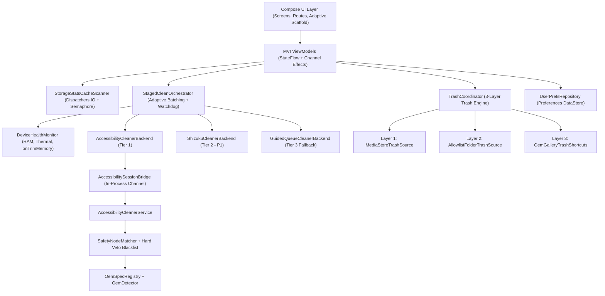
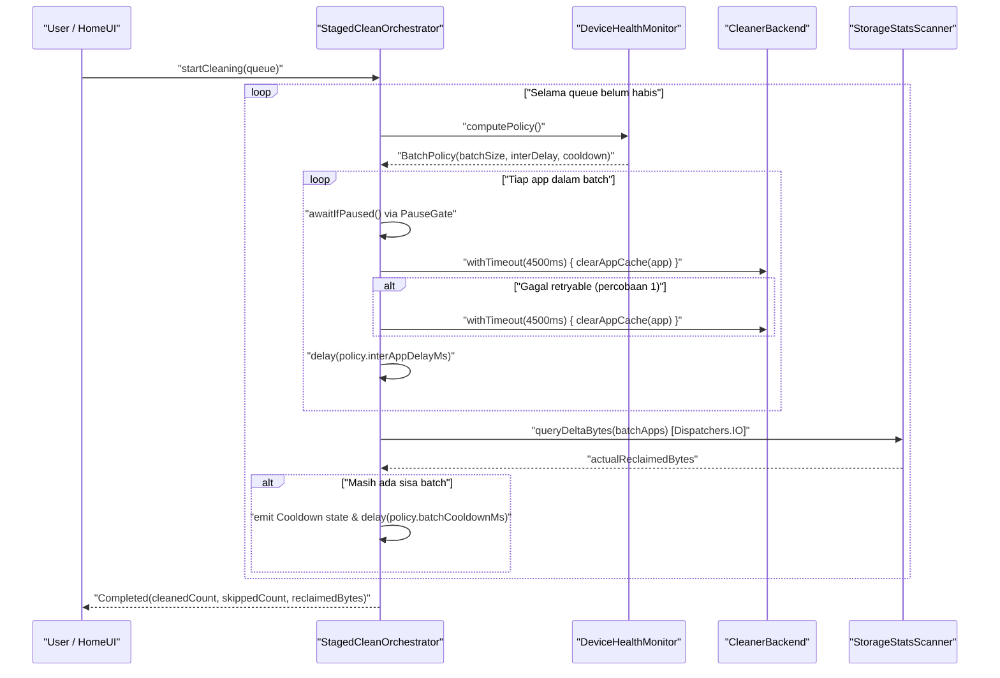

# Technical Design Document (TDD) — habNoir Clean

> **Dokumen:** TDD-001 · **Versi:** 1.0.0 · **Rujukan PRD:** [`docs/PRD.md`](file:///c:/Users/Administrator/Documents/Coding%20Project/Android%20APP/docs/PRD.md)  
> **Tanggal:** 21 November 2026 · **Target SDK:** `minSdk = 31` (Android 12) · `compileSdk = 37` / `targetSdk = 37` (Android 17)  
> **Standar Engineering:** Mengacu penuh pada 10 skill open-source teraudit di [`SKILLS_MANIFEST.md`](file:///c:/Users/Administrator/Documents/Coding%20Project/Android%20APP/.agents/skills/SKILLS_MANIFEST.md)

---

## 1. Arsitektur Sistem & Prinsip Desain Teknis

### 1.1 Gambaran Arsitektur (*Single-Module Clean Layered*)
Untuk mengejar **ukuran APK release ≤ 3.5 MB**, **cold start ≤ 450 ms**, dan **jejak RAM ≤ 55 MB PSS** (mematuhi batas RAM ketat Android 17), proyek dibangun sebagai **single Android application module (`:app`)** dengan pemisahan paket logis yang tegas (*Clean Layered Architecture*) dan **Manual Dependency Injection (`AppContainer`)** tanpa code-generation framework berat (Hilt/Dagger) maupun ORM database (Room).



### 1.2 Keputusan Arsitektur Kunci (*Architecture Decision Records*)

| ADR | Keputusan | Alasan Teknis | Trade-off |
| :-: | :--- | :--- | :--- |
| **ADR-01** | **Manual DI (`AppContainer`)** alih-alih Hilt/Dagger | Menghilangkan overhead code-gen KSP, reflection/factory APK footprint, dan memotong waktu cold-start di SoC *entry-level*. | Wiring manual di `AppContainer.kt` (~80 baris), mudah diganti fake pada unit test. |
| **ADR-02** | **Single-Process Architecture** (`AccessibilityCleanerService` satu proses dengan `:app`) | Android 17 membebankan batas RAM per proses dan membekukan proses terpisah yang berkomunikasi via self-broadcast. Satu proses membagi objek `AppContainer` langsung via `Channel`/`StateFlow` tanpa IPC Binder internal. | Wajib menjaga konsumsi RAM UI + Service tetap **≤ 55 MB PSS** dan melepas resource UI agresif saat di latar belakang. |
| **ADR-03** | **Preferences DataStore** alih-alih Room/SQLite | Data persisten hanya berupa whitelist paket (`Set<String>`), threshold byte, total ruang yang dibersihkan, dan preferensi ringkas. Menghindari dependensi SQLite/Room menghemat ~700 KB–1.2 MB APK. | Tidak menyimpan log historis per-aplikasi berskala ribuan baris (tidak dibutuhkan di PRD). |
| **ADR-04** | **Semantic `ACTION_CLICK`** alih-alih `dispatchGesture()` | `AccessibilityNodeInfo.performAction(ACTION_CLICK)` berjalan deterministik lintas resolusi layar, lipatan (*foldable*), dan DPI tanpa mengklaim kapabilitas `canPerformGestures`. | Memerlukan `OemSpecRegistry` untuk mencocokkan label tombol Bahasa Indonesia & Inggris per OEM. |
| **ADR-05** | **Nol Izin `INTERNET`** di `AndroidManifest.xml` | Jaminan privasi matematis yang dapat diaudit pengguna & F-Droid via `aapt2 dump permissions`. | Seluruh profil `OemSpec` harus dibundel lokal di APK dan tidak ada telemetry jarak jauh. |

---

## 2. Toolchain, Konfigurasi Gradle (AGP 9 + Kotlin 2.x K2) & Strategi R8 Full Mode

### 2.1 Version Catalog (`gradle/libs.versions.toml`)
Mengikuti standar **AGP 9.x + Kotlin 2.x K2** dan skill `r8-analyzer` / `glance-appwidget-updates-and-memory` / `compose-kotlin-agent-skills`:

```toml
[versions]
agp = "9.3.0"                # Gunakan >= 9.3.0 untuk blok optimization {} & R8 Analyzer task
kotlin = "2.1.20"            # K2 compiler wajib aktif penuh
composeBom = "2025.05.00"
activityCompose = "1.10.1"
coreKtx = "1.16.0"
lifecycle = "2.9.0"
datastore = "1.1.7"
glance = "1.2.0"             # P1 Widget
shizuku = "13.1.5"           # P1 Shizuku API (opsional runtime)
coroutines = "1.10.2"
junit4 = "4.13.2"
turbine = "1.2.0"
robolectric = "4.14.1"

[libraries]
androidx-core-ktx = { module = "androidx.core:core-ktx", version.ref = "coreKtx" }
androidx-activity-compose = { module = "androidx.activity:activity-compose", version.ref = "activityCompose" }
androidx-compose-bom = { module = "androidx.compose:compose-bom", version.ref = "composeBom" }
androidx-compose-ui = { module = "androidx.compose.ui:ui" }
androidx-compose-foundation = { module = "androidx.compose.foundation:foundation" }
androidx-compose-material3 = { module = "androidx.compose.material3:material3" }
androidx-compose-ui-tooling-preview = { module = "androidx.compose.ui:ui-tooling-preview" }
androidx-compose-ui-tooling = { module = "androidx.compose.ui:ui-tooling" }
androidx-lifecycle-runtime-compose = { module = "androidx.lifecycle:lifecycle-runtime-compose", version.ref = "lifecycle" }
androidx-lifecycle-viewmodel-compose = { module = "androidx.lifecycle:lifecycle-viewmodel-compose", version.ref = "lifecycle" }
androidx-datastore-preferences = { module = "androidx.datastore:datastore-preferences", version.ref = "datastore" }
androidx-glance-appwidget = { module = "androidx.glance:glance-appwidget", version.ref = "glance" }
androidx-glance-material3 = { module = "androidx.glance:glance-material3", version.ref = "glance" }
shizuku-api = { module = "dev.rikka.shizuku:api", version.ref = "shizuku" }
shizuku-provider = { module = "dev.rikka.shizuku:provider", version.ref = "shizuku" }
kotlinx-coroutines-android = { module = "org.jetbrains.kotlinx:kotlinx-coroutines-android", version.ref = "coroutines" }

# Testing
junit = { module = "junit:junit", version.ref = "junit4" }
kotlinx-coroutines-test = { module = "org.jetbrains.kotlinx:kotlinx-coroutines-test", version.ref = "coroutines" }
turbine = { module = "app.cash.turbine:turbine", version.ref = "turbine" }
robolectric = { module = "org.robolectric:robolectric", version.ref = "robolectric" }
androidx-compose-ui-test-junit4 = { module = "androidx.compose.ui:ui-test-junit4" }
androidx-compose-ui-test-manifest = { module = "androidx.compose.ui:ui-test-manifest" }

[plugins]
android-application = { id = "com.android.application", version.ref = "agp" }
kotlin-compose = { id = "org.jetbrains.kotlin.plugin.compose", version.ref = "kotlin" }
```

### 2.2 Konfigurasi `app/build.gradle.kts` & R8 Full Mode
- **JDK:** JDK 17+ (mesin lokal terdeteksi JDK 27; target JVM bytecode disetel ke `JavaVersion.VERSION_17` agar kompatibel penuh dengan tooling Gradle & F-Droid reproducible build).
- **Optimasi Release (AGP 9.3+):** Menggunakan blok `optimization { enable = true }` (yang mengaktifkan R8 full mode, resource shrinking, dan `proguard-android-optimize.txt` secara otomatis) serta menghindari `android.enableR8.fullMode=false` di `gradle.properties`.

```kotlin
android {
    namespace = "xyz.habnoir.clean"
    compileSdk = 37

    defaultConfig {
        applicationId = "xyz.habnoir.clean"
        minSdk = 31
        targetSdk = 37
        versionCode = 1
        versionName = "1.0.0"

        testInstrumentationRunner = "androidx.test.runner.AndroidJUnitRunner"
        resourceConfigurations += listOf("in", "en") // Pangkas locale resource tak terpakai
    }

    buildFeatures {
        compose = true
        buildConfig = false
    }

    buildTypes {
        release {
            optimization {
                enable = true
            }
            proguardFiles("proguard-rules.pro")
            // Catatan: jika AGP < 9.3.0, gunakan isMinifyEnabled = true, isShrinkResources = true,
            // dan getDefaultProguardFile("proguard-android-optimize.txt")
        }
    }

    flavorDimensions += "distribution"
    productFlavors {
        create("foss") {
            dimension = "distribution" // GitHub / F-Droid: mendukung MANAGE_EXTERNAL_STORAGE opt-in Layer 2
        }
        create("store") {
            dimension = "distribution" // Opsional Play Store compliant (tanpa MANAGE_EXTERNAL_STORAGE)
        }
    }

    compileOptions {
        sourceCompatibility = JavaVersion.VERSION_17
        targetCompatibility = JavaVersion.VERSION_17
    }

    packaging {
        resources {
            excludes += setOf(
                "/META-INF/{AL2.0,LGPL2.1}",
                "/META-INF/*.kotlin_module",
                "DebugProbesKt.bin"
            )
        }
    }
}
```

**`app/proguard-rules.pro` (Minimal & Zero Wildcard Broad Rules):**
```proguard
# Hanya pertahankan zero-arg constructor ActionCallback untuk Jetpack Glance (P1)
-keep class * implements androidx.glance.appwidget.action.ActionCallback {
    public <init>();
}
```
> **Catatan R8:** `OemSpecRegistry` dan `AppContainer` ditulis langsung sebagai Kotlin objects/data classes tanpa deserialisasi refleksi JSON (atau memakai parser manual `org.json` bawaan Android SDK) sehingga **0 keep-rule** tambahan diperlukan. Ikon UI memakai gambar vektor custom tipis (~15–20 ikon Path) alih-alih bundel penuh `material-icons-extended` (yang bisa membengkakkan APK hingga > 10 MB sebelum shrinking!).

### 2.3 Anggaran Ukuran APK Release (Target ≤ 3.5 MB)
| Komponen | Estimasi Setelah R8 Full Mode | Catatan Penghematan |
| :--- | :---: | :--- |
| Kotlin Stdlib + Coroutines | ~450 KB | R8 menghapus modul refleksi & utilitas tak terpakai |
| Jetpack Compose Runtime, UI, Foundation, M3 | ~1.550 KB | Tanpa `material-icons-extended`; ikon digambar via `ImageVector` custom |
| DataStore Preferences + Lifecycle | ~180 KB | Tanpa Room, tanpa Hilt, tanpa OkHttp/Coil |
| Font Subset (`Cinzel` + `Geist` Latin dasar) | ~130 KB | Subset karakter Latin + angka tabular saja |
| Kode Aplikasi + `OemSpecRegistry` + Vector Assets | ~280 KB | Logo `HN` disimpan sebagai Vector Drawable XML (< 3 KB) |
| Glance AppWidget + Shizuku API (P1) | ~320 KB | Ditambahkan di P1, masih di bawah batas target |
| **Total Estimasi Release APK** | **~2.91 MB** | **Jauh di bawah target ≤ 3.5 MB & hard cap 5.0 MB** |

---

## 3. Model Domain, Kontrak MVI & Manajemen State

### 3.1 Model Domain Inti (`model/`)
```kotlin
@JvmInline
value class PackageName(val raw: String)

enum class EngineTier {
    ACCESSIBILITY_STAGED,
    SHIZUKU_STAGED,
    GUIDED_QUEUE
}

enum class DeviceTier {
    LOW_RAM,      // <= 4 GB atau isLowRamDevice
    MID_RANGE,    // > 4 GB .. <= 8 GB
    FLAGSHIP,     // > 8 GB
    THERMAL_GUARD // Suhu >= THERMAL_STATUS_MODERATE atau onTrimMemory kritis
}

data class BatchPolicy(
    val tier: DeviceTier,
    val batchSize: Int,
    val interAppDelayMs: Long,
    val batchCooldownMs: Long
)

/**
 * Model datar primitif untuk item LazyColumn.
 * Sesuai skill jetpack-compose-performance (Strong Skipping Mode):
 * tipe flat ber-properti primitif otomatis dianggap stabil oleh compiler Compose
 * tanpa perlu membungkus List dengan @Immutable / ImmutableList.
 */
data class AppCacheItemUi(
    val packageName: PackageName,
    val appLabel: String,
    val cacheBytes: Long,
    val formattedSize: String,
    val isWhitelisted: Boolean
)

sealed interface CleanSessionState {
    data object Idle : CleanSessionState
    data class Scanning(val scannedCount: Int, val totalPackages: Int) : CleanSessionState
    data class Cleaning(
        val currentBatch: Int,
        val totalBatches: Int,
        val processedApps: Int,
        val totalApps: Int,
        val activeAppLabel: String,
        val reclaimedBytesSoFar: Long,
        val policy: BatchPolicy,
        val isPaused: Boolean,
        val pauseReason: PauseReason? = null
    ) : CleanSessionState
    data class Cooldown(
        val currentBatch: Int,
        val totalBatches: Int,
        val remainingMs: Long,
        val reclaimedBytesSoFar: Long,
        val isThermalThrottled: Boolean
    ) : CleanSessionState
    data class Completed(
        val cleanedCount: Int,
        val skippedCount: Int,
        val reclaimedBytes: Long
    ) : CleanSessionState
    data class Aborted(val reclaimedBytesSoFar: Long, val reason: AbortReason) : CleanSessionState
}

enum class PauseReason { USER_REQUEST, USER_SCREEN_TOUCH, THERMAL_COOLDOWN }
enum class AbortReason { USER_STOP, ACCESSIBILITY_REVOKED, ADVANCED_PROTECTION_BLOCKED }
```

### 3.2 Kontrak MVI Ketat & Strong Skipping Guardrails
Setiap ViewModel mematuhi aturan mutlak dari `compose-kotlin-agent-skills` dan `jetpack-compose-performance`:
1. **State & Mutasi Atomik:**
   - Ekspos `val uiState: StateFlow<HomeUiState>` (dilarang keras `_state.value = ...` atau mutasi list di dalam state; wajib `_state.update { current -> ... }`).
   - Satu kali efek samping (*one-shot* seperti membuka Intent Android, Snackbar, atau memicu `MediaStore.createDeleteRequest`) dikirim lewat `Channel<HomeEffect>(Channel.BUFFERED)` dan diekspos sebagai `Flow<HomeEffect>`.
2. **Lifecycle-Aware Collection:**
   - Route composable menggunakan `val state by viewModel.uiState.collectAsStateWithLifecycle()`.
3. **Strong Skipping Optimization:**
   - `HomeUiState` yang membawa `val topApps: List<AppCacheItemUi>` **tidak** diberi anotasi `@Immutable` agar Compose Strong Skipping membandingkan referensi list secara `O(1)` (`===`) alih-alih `.equals()` `O(N)`.
   - Penghitungan angka terformat (`formattedSize`) dilakukan sekali saat pemetaan di `Dispatchers.Default` sebelum masuk state UI, bukan di dalam body `@Composable`.

### 3.3 Skema `Preferences DataStore` (`UserPrefsRepository`)
File DataStore tunggal `habnoir_clean_prefs.preferences_pb` diakses secara `suspend` di `Dispatchers.IO` (mengeliminasi risiko ANR dari `SharedPreferences.commit()/apply()`):

| Key (`Preferences.Key<T>`) | Tipe | Default | Kegunaan |
| :--- | :--- | :--- | :--- |
| `whitelisted_packages` | `Set<String>` | `emptySet()` | Daftar paket yang dikunci agar tidak dibersihkan |
| `min_cache_threshold_bytes` | `Long` | `5_242_880L` (5 MB) | Ambang batas minimum cache agar ikut dibersihkan |
| `preferred_engine_mode` | `String` | `"AUTO"` | `AUTO` / `ACCESSIBILITY` / `SHIZUKU` / `GUIDED` |
| `total_freed_bytes` | `Long` | `0L` | Statistik total ruang yang dilegakan sepanjang waktu |
| `last_clean_epoch_ms` | `Long` | `0L` | Timestamp pembersihan terakhir untuk cooldown/UI |
| `onboarding_completed` | `Boolean` | `false` | Status penyelesaian Onboarding Wizard OEM |
| `reminder_enabled` | `Boolean` | `false` | Pengingat pasif berkala (opt-in, mati secara default) |

---

## 4. Desain Engine Pemindai Cache (`StorageStatsCacheScanner`)

### 4.1 Alur Scanning Non-Blocking (`Dispatchers.IO`)
Memanggil `StorageStatsManager.queryStatsForPackage()` melibatkan transaksi Binder ke `StorageStatsService`/`installd`. Menjalankannya di thread utama atau meluncurkan 150 coroutine serentak dapat memicu ANR atau saturasi thread pool Binder.

**Desain Konkurensi Terkontrol:**
1. Query daftar aplikasi terpasang via `PackageManager`:
   - API 33+: `pm.getInstalledApplications(PackageManager.ApplicationInfoFlags.of(0L))`
   - API 31–32: `pm.getInstalledApplications(0)`
2. Filter awal:
   - Kecualikan aplikasi sistem inti yang dilindungi **`SystemProcessGuard`**.
   - Catat `uid` ke dalam `MutableIntSet` (`androidx.collection.MutableIntSet` — tanpa boxing `Integer`!). Jika dua paket berbagi `sharedUserId` dengan `uid` yang sama, panggil **`queryStatsForUid(storageUuid, uid)`** satu kali saja atau deduplikasi agar total `cacheBytes` tidak dihitung ganda.
3. Jalankan pemindaian menggunakan **`Semaphore(permits = 4)`** pada `Dispatchers.IO` dengan `async` berbatas, membaca `stats.cacheBytes` (pada API 31+, `cacheBytes` mencakup internal + external cache terkelola pada volume `StorageManager.UUID_DEFAULT`; untuk volume SD card/secondary yang terdeteksi via `StorageManager.storageVolumes`, gunakan `volume.uuid` bila tersedia dan mounted).
4. Urutkan hasil secara menurun (`sortedByDescending { it.cacheBytes }`) di `Dispatchers.Default`, terapkan flag whitelist dari DataStore dan filter threshold.

### 4.2 `SystemProcessGuard` (Daftar Pengecualian Dinamis)
Agar sistem Android & UI pengguna tidak pernah berkedip atau kehilangan state keyboard/launcher:
- `context.packageName` (aplikasi ini sendiri)
- `com.android.systemui`, `com.android.settings`, `com.android.providers.settings`
- `com.android.packageinstaller`, `com.google.android.packageinstaller`
- `com.miui.securitycenter`, `com.coloros.safecenter`, `com.oplus.safecenter`, `com.vivo.permissionmanager`, `com.transsion.phonemaster`, `com.samsung.android.lool`
- **Launcher Aktif Dinamis:** resolve via `Intent(Intent.ACTION_MAIN).addCategory(Intent.CATEGORY_HOME)`
- **IME / Keyboard Aktif Dinamis:** ambil package name dari `Settings.Secure.getString(cr, Settings.Secure.DEFAULT_INPUT_METHOD)` (dibungkus `ComponentName.unflattenFromString`).

### 4.3 `AppIconMemoryCache` (Pengganti Coil/Glide)
- `android.util.LruCache<String, ImageBitmap>` dengan batas ukuran entri tetap **maksimal 4 MB** (menghitung `bitmap.allocationByteCount`).
- Ikon aplikasi di-render pada ukuran tetap **`40dp`** (`with(density) { 40.dp.roundToPx() }`) menggunakan `Bitmap.createBitmap(sizePx, sizePx, Bitmap.Config.ARGB_8888)` di `Dispatchers.Default` dan dibersihkan otomatis saat `ComponentCallbacks2.onTrimMemory(TRIM_MEMORY_UI_HIDDEN)`.

---

## 5. Desain Staged Batch Cleaning Engine (`StagedCleanOrchestrator` & `DeviceHealthMonitor`)

### 5.1 Kontrak `CleanerBackend`
```kotlin
sealed interface StepResult {
    data object Cleared : StepResult
    data object AlreadyClean : StepResult
    data class Skipped(val reason: SkipReason) : StepResult
    data class Failed(val retryable: Boolean, val reason: String) : StepResult
}

enum class SkipReason { BLACKLIST_BLOCKED, TIMEOUT, BUTTON_NOT_FOUND, USER_WHITELISTED }

interface CleanerBackend {
    val tier: EngineTier
    suspend fun isReady(): Boolean
    suspend fun clearAppCache(target: AppCacheItemUi, spec: OemCleanSpec): StepResult
}
```

### 5.2 Algoritma `DeviceHealthMonitor`
Dievaluasi **sebelum memulai setiap batch** (bukan hanya di awal sesi!) sehingga engine beradaptasi langsung bila suhu HP naik di tengah proses:

```kotlin
class DeviceHealthMonitor(private val context: Context) : ComponentCallbacks2 {
    private val memoryTrimTriggered = AtomicBoolean(false)

    fun computePolicy(): BatchPolicy {
        val am = context.getSystemService(ActivityManager::class.java)
        val pm = context.getSystemService(PowerManager::class.java)

        val memInfo = ActivityManager.MemoryInfo()
        am?.getMemoryInfo(memInfo)
        val totalRamGb = memInfo.totalMem / (1024.0 * 1024.0 * 1024.0)
        val isLowRam = am?.isLowRamDevice == true || totalRamGb <= 4.2
        val lowAvailMem = memInfo.lowMemory

        val thermal = pm?.currentThermalStatus ?: PowerManager.THERMAL_STATUS_NONE
        val isThermalHot = thermal >= PowerManager.THERMAL_STATUS_MODERATE

        return when {
            isThermalHot || lowAvailMem || memoryTrimTriggered.getAndSet(false) -> BatchPolicy(
                tier = DeviceTier.THERMAL_GUARD,
                batchSize = 3,
                interAppDelayMs = 1_000L,
                batchCooldownMs = 5_000L
            )
            isLowRam -> BatchPolicy(
                tier = DeviceTier.LOW_RAM,
                batchSize = 5,
                interAppDelayMs = 800L,
                batchCooldownMs = 3_500L
            )
            totalRamGb <= 8.5 -> BatchPolicy(
                tier = DeviceTier.MID_RANGE,
                batchSize = 8,
                interAppDelayMs = 500L,
                batchCooldownMs = 2_500L
            )
            else -> BatchPolicy(
                tier = DeviceTier.FLAGSHIP,
                batchSize = 12,
                interAppDelayMs = 350L,
                batchCooldownMs = 1_500L
            )
        }
    }

    override fun onTrimMemory(level: Int) {
        if (level >= ComponentCallbacks2.TRIM_MEMORY_RUNNING_LOW) {
            memoryTrimTriggered.set(true)
        }
    }
    // ... onConfigurationChanged / onLowMemory no-op / set flag
}
```

### 5.3 Alur Eksekusi Staged Batch, Watchdog & `PauseGate`



**Detail Teknis Kunci:**
- **`PauseGate` Responsif (< 50 ms):** `private val paused = MutableStateFlow(false)`. Sebelum memproses tiap app dan di setiap iterasi `Cooldown`, orchestrator memanggil `paused.first { !it }`. Ketika user menekan tombol **Hentikan**, `activeJob?.cancel()` langsung membatalkan coroutine dan mengeksekusi blok `finally` untuk mengirim `GLOBAL_ACTION_BACK` (bila berada di halaman Settings) dan memperbarui statistik `total_freed_bytes` ke DataStore.
- **Perhitungan Ruang Lega Nyata:** Karena beberapa OEM menampilkan ukuran cache sedikit berbeda dari cache OS sebelum pembersihan selesai tuntas, setelah setiap batch selesai + jeda singkat `300 ms`, orchestrator meng-query ulang `StorageStatsManager` untuk paket-paket dalam batch tersebut (`maxOf(0L, beforeBytes - afterBytes)`), lalu menampilkan angka penghematan aktual (bukan estimasi fiktif!).

---

## 6. Desain Accessibility Service & Invariant Keamanan Anti-Hapus-Data

### 6.1 Arsitektur `AccessibilitySessionBridge` (In-Process, Zero Leak)
- `AccessibilitySessionBridge` hidup di dalam `AppContainer` sebagai singleton ringan.
- `AccessibilityCleanerService` **tidak pernah** menyimpan referensi `Activity` maupun menulis UI secara langsung.
- Saat `onServiceConnected()`, service mendaftarkan callback aksi ringan (`AccessibilityActionDriver`) ke `AccessibilitySessionBridge`. Saat `onUnbind()` / `onDestroy()`, registrasi dilepas seketika dan seluruh referensi `AccessibilityNodeInfo` hasil snapshot dibuang (`recycle()` pada API < 33 jika diperlukan, atau dilepas dari heap karena sejak API 33+ node lifecycle dikelola garbage collector).
- **Anti-ANR pada `onAccessibilityEvent(event)`:** Callback `onAccessibilityEvent` berjalan di **Main Thread**. Oleh karena itu:
  1. Jika tidak ada sesi pembersihan aktif (`!bridge.isSessionActive`), method langsung `return` dalam `< 0.1 ms` (0 konsumsi CPU saat idle!).
  2. Jika sesi aktif, lakukan traversal dangkal maksimal kedalaman `12` level untuk mengekstrak `List<NodeSnapshot>` (immutable value object: `text`, `contentDesc`, `viewId`, `isClickable`, `isEnabled`, `className`, `bounds`, `parentId`, `nodeRef` lemah) dan kirim ke `Channel<WindowSnapshot>(Channel.CONFLATED)`. **Nol I/O, nol sleep, nol blocking loop** di `onAccessibilityEvent`.

### 6.2 Konfigurasi `res/xml/accessibility_service_config.xml`
```xml
<accessibility-service xmlns:android="http://schemas.android.com/apk/res/android"
    android:accessibilityEventTypes="typeWindowStateChanged|typeWindowContentChanged"
    android:accessibilityFeedbackType="feedbackGeneric"
    android:accessibilityFlags="flagReportViewIds|flagRetrieveInteractiveWindows"
    android:canRetrieveWindowContent="true"
    android:description="@string/accessibility_service_description"
    android:notificationTimeout="150"
    android:settingsActivity="xyz.habnoir.clean.MainActivity" />
```
> **Penting:** Atribut `android:canPerformGestures` sengaja **tidak dideklarasikan** guna memperkuat postur keamanan aplikasi dan meyakinkan peninjau F-Droid/pengguna bahwa aplikasi tidak bisa menyimulasikan sentuhan sembarangan (mis. menekan tombol perbankan/transfer).

### 6.3 `SafetyNodeMatcher` — Algoritma 4-Tahap Zero-False-Positive

```kotlin
object SafetyNodeMatcher {
    private val HARD_VETO_SUBSTRINGS = listOf(
        "hapus semua data", "hapus data", "hapus penyimpanan", "bersihkan semua data",
        "clear all data", "clear data", "clear storage", "manage space", "kelola ruang",
        "uninstall", "copot", "hapus instalan", "force stop", "paksa berhenti",
        "disable", "nonaktifkan", "hapus akun"
    )

    fun evaluateWindow(
        packageName: String,
        nodes: List<NodeSnapshot>,
        spec: OemCleanSpec
    ): MatchDecision {
        // 1. Cek apakah layar saat ini milik Settings OEM yang diizinkan
        if (packageName !in spec.settingsPackageIds) {
            return MatchDecision.ForeignWindow(packageName)
        }

        // 2. Cari tombol Clear Cache valid terlebih dahulu
        val cacheCandidate = findSafeMatchingNode(
            nodes = nodes,
            positiveLabels = spec.clearCacheButtonLabels,
            hintIds = spec.clearCacheViewIds
        )
        if (cacheCandidate != null) {
            if (!cacheCandidate.isClickableTargetEnabled) return MatchDecision.AlreadyClean
            return MatchDecision.ClickNode(cacheCandidate, ActionStep.CLEAR_CACHE)
        }

        // 3. Jika belum terlihat tombol cache, cari sub-menu Penyimpanan (OPPO/Vivo/Samsung/AOSP)
        val storageNavCandidate = findSafeMatchingNode(
            nodes = nodes,
            positiveLabels = spec.storageEntryLabels,
            hintIds = spec.storageEntryViewIds
        )
        if (storageNavCandidate != null) {
            return MatchDecision.ClickNode(storageNavCandidate, ActionStep.OPEN_STORAGE_SUBMENU)
        }

        return MatchDecision.NotReadyYet
    }

    internal fun isLabelBlacklisted(rawText: String?): Boolean {
        if (rawText.isNullOrBlank()) return false
        val normalized = rawText.trim().lowercase()
        return HARD_VETO_SUBSTRINGS.any { veto -> normalized.contains(veto) }
    }
}
```

**Aturan Tambahan Penjaga Keamanan (`SafetyNodeMatcher`):**
1. **Validasi Naik ke Parent (`resolveSafeClickableAncestor`):** Banyak UI Android modern (RecyclerView/Compose) menaruh `TextView` `"Hapus cache"` di dalam `LinearLayout` clickable. Saat menelusuri induk hingga maks **3 level** ke atas, **seluruh teks anak** di dalam induk clickable tersebut digabung dan dicek ulang terhadap `HARD_VETO_SUBSTRINGS`. Jika satu container membungkus `"Hapus data"` sekaligus `"Hapus cache"` tanpa terpisah clickable-nya, aksi **ditolak**.
2. **Protokol Bottom-Sheet Khusus Xiaomi (`MIUI` / `HyperOS`):**
   - Pada sebagian versi MIUI/HyperOS yang langsung menampilkan tombol bawah `Bersihkan data` (tanpa sub-menu `Penyimpanan` terpisah), `OemCleanSpec` Xiaomi **hanya** mengizinkan navigasi apabila opsi kedua adalah dialog konfirmasi aman:
   - Tahap A: Jika tombol `"Bersihkan cache"` / `"Hapus cache"` terlihat langsung -> klik langsung.
   - Tahap B: Jika berada di halaman Info Aplikasi `com.miui.securitycenter` dan belum masuk sub-menu, prioritaskan klik baris **`Penyimpanan`** (`Storage`) terlebih dahulu. Jika baris `Penyimpanan` tidak ada dan satu-satunya jalur adalah dialog bawah (`clear_data_menu`), hanya diizinkan membuka dialog bila aturan OEM secara eksplisit menandai profil dialog tersebut terverifikasi, lalu pada window dialog wajib hanya menekan node yang **persis cocok** (`equals`, bukan `contains`) dengan `"bersihkan cache"` / `"hapus cache"` / `"clear cache"`, serta diverifikasi **bukan** `"hapus semua data"`.
3. **Deteksi Interupsi Pengguna:** Bila selama menunggu window berikutnya `event.packageName` bukan anggota `spec.settingsPackageIds` dan bukan `xyz.habnoir.clean` (misal pengguna menekan Home atau membuka WhatsApp), orchestrator langsung beralih ke `PauseReason.USER_SCREEN_TOUCH`.

---

## 7. Desain `OemSpecRegistry` (Kompatibilitas HP Indonesia)

### 7.1 `OemDetector` (Tanpa Refleksi Privat Terlarang)
Android 14–17 membatasi refleksi API tersembunyi (`android.os.SystemProperties`). `OemDetector` mengidentifikasi keluarga OEM secara legal menggunakan `Build.MANUFACTURER`, `Build.BRAND`, plus pemeriksaan ketersediaan paket sistem (`packageManager.getPackageInfo`):

```kotlin
enum class OemFamily {
    XIAOMI_HYPEROS_MIUI,
    OPPO_REALME_COLOROS,
    VIVO_IQOO_FUNTOUCH,
    TRANSSION_XOS_HIOS,
    SAMSUNG_ONEUI,
    AOSP_GENERIC
}
```

| `OemFamily` | Deteksi (`MANUFACTURER` / `BRAND` + Paket Indikator) | `settingsPackageIds` | `storageEntryLabels` (ID / EN) | `clearCacheButtonLabels` (ID / EN) | Deep-Link Settings Baterai & Auto-Start (dengan Fallback Aman) |
| :--- | :--- | :--- | :--- | :--- | :--- |
| **`XIAOMI_HYPEROS_MIUI`** | `xiaomi`, `redmi`, `poco` + `com.miui.securitycenter` | `com.android.settings`, `com.miui.securitycenter` | `penyimpanan`, `storage` | `bersihkan cache`, `hapus cache`, `clear cache` | `com.miui.securitycenter/.AutoStartManagementActivity`, `com.miui.powerkeeper/.ui.HiddenAppsConfigActivity` |
| **`OPPO_REALME_COLOROS`** | `oppo`, `realme`, `oneplus` + `com.oplus.appdetail` / `com.coloros.safecenter` | `com.android.settings`, `com.oplus.appdetail` | `penggunaan penyimpanan`, `penyimpanan`, `storage usage`, `storage` | `hapus cache`, `bersihkan cache`, `clear cache` | `com.coloros.safecenter/.permission.startup.StartupAppListActivity`, `com.oplus.safecenter/.startupapp.StartupAppListActivity` |
| **`VIVO_IQOO_FUNTOUCH`** | `vivo`, `iqoo` + `com.vivo.permissionmanager` / `com.iqoo.secure` | `com.android.settings` | `penyimpanan & cache`, `penyimpanan`, `storage & cache`, `internal storage` | `hapus cache`, `bersihkan cache`, `clear cache` | `com.vivo.permissionmanager/.activity.BgStartUpManagerActivity`, `com.iqoo.secure/.ui.phoneoptimize.AddWhiteListActivity` |
| **`TRANSSION_XOS_HIOS`** | `infinix`, `tecno`, `itel` + `com.transsion.phonemaster` | `com.android.settings`, `com.transsion.phonemaster` | `penyimpanan & cache`, `penyimpanan`, `storage & cache` | `hapus cache`, `clear cache` | `com.transsion.phonemaster/.MainActivity`, fallback `ACTION_REQUEST_IGNORE_BATTERY_OPTIMIZATIONS` / App Details |
| **`SAMSUNG_ONEUI`** | `samsung` + `com.samsung.android.lool` | `com.android.settings` | `penyimpanan`, `storage` | **`hapus memori`**, `hapus cache`, `clear cache` | `ACTION_APPLICATION_DETAILS_SETTINGS` + panduan *Baterai -> Tidak dibatasi* & *Never auto sleeping apps* |
| **`AOSP_GENERIC`** | Lainnya (Pixel, Nokia, Motorola, Asus, Nothing) | `com.android.settings` | `penyimpanan & cache`, `storage & cache`, `storage` | `hapus cache`, `clear cache` | `ACTION_IGNORE_BATTERY_OPTIMIZATION_SETTINGS` / App Details |

**Keamanan Intent Deep-Link OEM (`android-intent-security`):**
Setiap kandidat `Intent` OEM diuji terlebih dahulu dengan `intent.resolveActivity(packageManager)` dan dipastikan `resolveInfo.activityInfo.exported == true` sebelum memanggil `startActivity()`. Jika tidak ditemukan atau `SecurityException` terjadi pada ROM versi tertentu, aplikasi langsung jatuh mulus (*graceful fallback*) ke `Settings.ACTION_APPLICATION_DETAILS_SETTINGS` milik paket sendiri sambil menampilkan instruksi teks yang ramah.

---

## 8. Desain 3-Layer Trash & Folder Sampah Engine

### 8.1 Layer 1: `MediaStoreTrashSource` (Universal Android 12–17)
Berjalan di `Dispatchers.IO`, meng-query 4 koleksi utama (`Images.Media.EXTERNAL_CONTENT_URI`, `Video.Media.EXTERNAL_CONTENT_URI`, `Audio.Media.EXTERNAL_CONTENT_URI`, dan `Files.getContentUri(MediaStore.VOLUME_EXTERNAL)`):

```kotlin
val queryArgs = Bundle().apply {
    putInt(MediaStore.QUERY_ARG_MATCH_TRASHED, MediaStore.MATCH_ONLY)
}
val projection = arrayOf(
    MediaStore.MediaColumns._ID,
    MediaStore.MediaColumns.DISPLAY_NAME,
    MediaStore.MediaColumns.SIZE,
    MediaStore.MediaColumns.DATE_EXPIRES
)
```
- **Penghapusan Bertahap (Anti-`TransactionTooLargeException`):** Binder transaction buffer Android memiliki batas ~1 MB. Apabila ada 2.000 file di trash, mengirim seluruh URI sekaligus akan crash. Engine memotong daftar URI ke dalam chunk **`150` URI per batch** dan memanggil `MediaStore.createDeleteRequest(contentResolver, chunk)` satu per satu via `ActivityResultLauncher<IntentSenderRequest>` dengan indikator kemajuan (`Batch 1/4 Sampah Galeri`).

### 8.2 Layer 2: `AllowlistFolderTrashSource` (Opt-In `MANAGE_EXTERNAL_STORAGE` / SAF)
Aktif **hanya** pada flavor `foss` bila `Environment.isExternalStorageManager()` bernilai `true` (atau melalui URI pohon direktori SAF pilihan user).
- **Validasi Path Ketat (`isAllowedTrashDirectory`):**
  1. Dapatkan root canonical path (`Environment.getExternalStorageDirectory().canonicalPath`, umumnya `/storage/emulated/0`).
  2. Tolak **symlink** (`Files.isSymbolicLink(path)` -> skip) untuk mencegah serangan path traversal.
  3. Hanya izinkan traversal direktori teratas (maks kedalaman 4 dari root) yang **cocok dengan salah satu path relatif atau nama folder terverifikasi berikut**:
     - Root relatif eksplisit: `MIUI/Gallery/cloud/.trashBin`, `DCIM/.Trash`, `Pictures/.Trash`, `Movies/.Trash`, `Download/.Trash`, `.ColorOS/.recycle`, `.vivo_recycle`, `.HiOS_Trash`, `.XOS_Trash`
     - Nama segmen folder terminal persis (case-insensitive): `.trash`, `.trashbin`, `.recycle`, `.recyclebin`, `recyclebin`, `.globaltrash`, atau regex `^\.trash-.*$`
     - File yatim MediaStore di dalam sub-folder media: nama file cocok dengan regex `^\.trashed-\d+-.*$` **dan** `lastModified()` berumur lebih dari 1 menit (agar tidak mengganggu operasi write MediaStore yang sedang berlangsung).
  4. **Penghapusan Bertahap:** Hapus isi folder terverifikasi dalam potongan **50 file/batch** dengan `yield()` + `delay(50L)` di `Dispatchers.IO`. **Larangan mutlak:** Tidak pernah memanggil `deleteRecursively()` pada direktori induk seperti `DCIM`, `Pictures`, `WhatsApp`, `Documents`, atau `Download`.

### 8.3 Layer 3: `OemGalleryTrashShortcuts`
Menyediakan kartu pintasan 1-ketuk ke Galeri bawaan agar pengguna tidak perlu mencari menu tersembunyi untuk sampah terenkripsi OEM:
- Probe aman via `packageManager.getLaunchIntentForPackage(pkg)` / `resolveActivity()` terhadap:
  - Google Photos (`com.google.android.apps.photos`), Files by Google (`com.google.android.apps.nbu.files`)
  - Xiaomi Gallery (`com.miui.gallery`), OPPO/Realme Photos (`com.coloros.gallery3d` / `com.oneplus.gallery`), Vivo Gallery (`com.vivo.gallery`), Samsung Gallery (`com.sec.android.gallery3d`), Transsion Gallery (`com.transsion.gallery` / `com.gallery20`)
- Menampilkan instruksi 1 baris di bawah tombol kartu (mis. *"Ketuk Album → Baru dihapus → Hapus semua"*).

---

## 9. Desain Implementasi habNoir UI (Material 3 Native, Anti-AI-Slop, Adaptive, Edge-to-Edge)

Implementasi antarmuka mengacu penuh pada [`UI_UX_DESIGN.md`](file:///c:/Users/Administrator/Documents/Coding%20Project/Android%20APP/docs/UI_UX_DESIGN.md) (v2.0 Anti-AI-Slop Edition) dan skill `impeccable` (`reference/android.md`), `frontend-design`, `hallmark`, `edge-to-edge`, `adaptive`, serta `jetpack-compose-performance`.

### 9.1 Sistem Token `HabNoirColors` (Editorial Obsidian + Warm Alabaster `HN`)
```kotlin
object HabNoirColors {
    val ObsidianVoid = Color(0xFF090A0F)        // Ground kanvas utama
    val DockedBar = Color(0xFF0B0C11)           // TopAppBar & Material 3 NavigationBar
    val RaisedFolio = Color(0xFF10121A)         // ModalBottomSheet & elevasi tonal
    val TonalFolio = Color(0xFF171A24)          // Search bar, segmen kontrol aktif, dialog

    val WarmAlabaster = Color(0xFFF4F2EC)       // Primary action, angka hero, teks utama (warna logo HN)
    val MutedSlate = Color(0xFFA7AAB5)          // Teks sekunder & label non-aktif
    val QuietInk = Color(0xFF747885)            // Metadata minor (rasio kontras >= 4.6:1)

    val Hairline = Color(0x17F4F2EC)            // 9% Warm Alabaster — pemisah baris 0.5.dp
    val ActiveHairline = Color(0x38F4F2EC)      // 22% Warm Alabaster — border fokus

    val WarmChampagne = Color(0xFFE2C799)       // Aksen tunggal: Whitelist lock, OEM alert, Thermal Guard
    val MutedClayRose = Color(0xFFE08A8A)       // Aksi destruktif/stop & peringatan ruang > 92%
    val StrataSystem = Color(0xFF2A2F3D)        // Segmen data sistem & pribadi di Storage Strata Bar
}
```

### 9.2 Permukaan Editorial Tanpa *Card-Spam* (`Modifier.drawWithCache`)
Mematuhi `jetpack-compose-performance` dan larangan *card-inside-card* dari `impeccable` / `hallmark`:
- **Unboxed Hairline Ledger:** Baris daftar aplikasi di Layar `Ruang` dan `Aplikasi` maupun 3 bagian di Layar `Sampah` dirender langsung di atas `ObsidianVoid` dengan pemisah horizontal `0.5.dp` (`Hairline`), **tanpa** membungkus setiap baris dengan kartu persegi atau shadow dekoratif.
- **Calibrated Storage Strata Bar (`Modifier.drawWithCache`):** Menggambar 3 segmen proporsional (`StrataSystem`, `WarmAlabaster`, `WarmChampagne`) setinggi `10.dp` pada fase Draw (0 alokasi objek per frame, 0 ms GPU blur).
- **2-Tier Modal Scrim:** Blur shader opsional hanya diterapkan pada scrim di belakang `ModalBottomSheet` bila `!isLowRamDevice` (Tier A); perangkat RAM ≤ 4 GB (Tier B) memakai scrim gelap solid `#090A0F` @ `72%` agar tetap **60fps**.

### 9.3 Edge-to-Edge, Material 3 Navigation & Tata Letak Adaptif (API 31–37)
Mematuhi `impeccable/reference/android.md`, `edge-to-edge`, dan `adaptive` skill:
1. **Inisialisasi `MainActivity.onCreate()`:**
   ```kotlin
   enableEdgeToEdge(
       statusBarStyle = SystemBarStyle.dark(android.graphics.Color.TRANSPARENT),
       navigationBarStyle = SystemBarStyle.dark(android.graphics.Color.TRANSPARENT)
   )
   window.isNavigationBarContrastEnforced = false
   ```
2. **Navigasi Material 3 Native (3 Destinasi + Setelan di TopAppBar):**
   - **Compact (`width < 600dp`):** Docked Material 3 `NavigationBar` (`Ruang`, `Aplikasi`, `Sampah`) menempel rapi di tepi bawah dengan pemisah `0.5.dp` `Hairline` atas — **bukan** floating pill iOS.
   - **Medium / Expanded (`width >= 600dp`):** Otomatis beralih ke Material 3 `NavigationRail` di kiri + tata letak 2-kolom (`45%` Storage Strata & tombol aksi di kiri, `55%` ledger aplikasi terboros di kanan).
   - **Halaman Sekunder (`Setelan & Kesehatan OEM`):** Dibuka dari ikon Setelan `48x48.dp` pada `TopAppBar` (atau ketuk chip merek HP) dan mendukung *Predictive Back Gesture* Android 14–17.
3. **Manifest Activity & Konsumsi Insets Tunggal:**
   - Setel `android:windowSoftInputMode="adjustResize"` dan **jangan** mengunci `android:screenOrientation` (syarat wajib Android 17).
   - `Scaffold` meneruskan `innerPadding` ke `contentPadding` dengan `.consumeWindowInsets(innerPadding)`, dan hanya layar `Aplikasi` yang menambahkan `.imePadding()` untuk kotak pencarian.
   - Feedback transien memakai **Material 3 `SnackbarHost`** di atas `NavigationBar` (bukan floating Toast custom).

### 9.4 Optimasi `LazyColumn` & Scroll Independen Daftar Aplikasi
- **Layar `Ruang` (App List Scroll Sendiri):** Area hero (*Storage Strata Bar* dan tombol `Bersihkan cache bertahap`) tetap *pinned* di bagian atas, sementara daftar aplikasi di bawahnya memakai `LazyColumn(modifier = Modifier.weight(1f))` dengan scroll independen (`key = { _, item -> item.packageName.raw }`, `contentType = { _, _ -> "home_app_row" }`).
- **Layar `Aplikasi` (`LazyColumn` Independen):** Kotak pencarian dan chip filter tetap *pinned* di atas, diikuti `LazyColumn(modifier = Modifier.weight(1f))` wajib `key = { _, item -> item.packageName.raw }` dan `contentType = { _, _ -> "app_cache_row" }`, tinggi baris minimum `64.dp`, tombol kunci `48x48.dp` dengan jarak minimal `8.dp`, serta `Modifier.semantics(mergeDescendants = true)`.

### 9.5 Glance 1-Tap Home Screen Widget (P1 — Android 17 Safe)
Mengikuti `glance-appwidget-updates-and-memory`:
- Gunakan `SizeMode.Responsive` (`DpSize(180.dp, 64.dp)` dan `DpSize(260.dp, 110.dp)`) di atas latar `#10121A` dengan `0.5.dp` border.
- Desain **zero-bitmap** (teks `Cinzel`/`Sans`, ikon vektor `HN` kecil) sehingga pemakaian memori `RemoteViews` `< 20 KB` — jauh di bawah batas `6 * W * H` Android 17.
- Override `onCompositionError(...)` dengan fallback `RemoteViews` teks polos `0` bitmap.
- Aksi ketuk memicu `MainActivity` (`ACTION_QUICK_CLEAN`) via `PendingIntent.FLAG_IMMUTABLE` — **tidak pernah** memanggil `startForegroundService()` dari receiver widget.
- Setiap pembaruan total cache memanggil `updateAppWidgetState(context, glanceId)` diikuti `HabNoirCleanWidget().updateAll(context)`.

---

## 10. Keamanan Manifest, Privasi & Penanganan Android 12–17

### 10.1 Blueprint `AndroidManifest.xml`
```xml
<manifest xmlns:android="http://schemas.android.com/apk/res/android"
    xmlns:tools="http://schemas.android.com/tools">

    <!-- DILARANG KERAS: Jangan pernah menambahkan android.permission.INTERNET atau ACCESS_NETWORK_STATE -->

    <!-- Untuk membaca ukuran cache per-app melalui StorageStatsManager -->
    <uses-permission
        android:name="android.permission.PACKAGE_USAGE_STATS"
        tools:ignore="ProtectedPermissions" />

    <!-- Visibilitas daftar aplikasi terpasang untuk pemindai cache Android 11+ -->
    <uses-permission
        android:name="android.permission.QUERY_ALL_PACKAGES"
        tools:ignore="QueryAllPackagesPermission" />

    <!-- Foreground Service saat pembersihan bertahap berjalan di atas layar Settings -->
    <uses-permission android:name="android.permission.FOREGROUND_SERVICE" />
    <uses-permission android:name="android.permission.FOREGROUND_SERVICE_SPECIAL_USE" />

    <!-- Notifikasi status proses & kontrol Jeda/Stop (API 33+) -->
    <uses-permission android:name="android.permission.POST_NOTIFICATIONS" />

    <!-- Hanya disuntikkan di flavor 'foss' via src/foss/AndroidManifest.xml untuk Layer 2 Trash -->
    <!-- <uses-permission android:name="android.permission.MANAGE_EXTERNAL_STORAGE" /> -->

    <application
        android:name=".HabNoirApp"
        android:allowBackup="false"
        android:icon="@mipmap/ic_launcher"
        android:label="@string/app_name"
        android:roundIcon="@mipmap/ic_launcher_round"
        android:supportsRtl="true"
        android:theme="@style/Theme.HabNoirClean">

        <activity
            android:name=".MainActivity"
            android:exported="true"
            android:launchMode="singleTop"
            android:windowSoftInputMode="adjustResize">
            <intent-filter>
                <action android:name="android.intent.action.MAIN" />
                <category android:name="android.intent.category.LAUNCHER" />
            </intent-filter>
        </activity>

        <service
            android:name=".engine.accessibility.AccessibilityCleanerService"
            android:exported="true"
            android:label="@string/accessibility_service_label"
            android:permission="android.permission.BIND_ACCESSIBILITY_SERVICE">
            <intent-filter>
                <action android:name="android.accessibilityservice.AccessibilityService" />
            </intent-filter>
            <meta-data
                android:name="android.accessibilityservice"
                android:resource="@xml/accessibility_service_config" />
        </service>

        <service
            android:name=".engine.staged.CleanExecutionForegroundService"
            android:exported="false"
            android:foregroundServiceType="specialUse">
            <property
                android:name="android.app.PROPERTY_SPECIAL_USE_FGS_SUBTYPE"
                android:value="Automated staged cache cleaning progress and instant pause/stop control." />
        </service>

        <!-- Komponen internal wajib android:exported="false" -->
        <provider
            android:name="rikka.shizuku.ShizukuProvider"
            android:authorities="${applicationId}.shizuku"
            android:enabled="true"
            android:exported="true"
            android:multiprocess="false"
            android:permission="android.permission.INTERACT_ACROSS_USERS_FULL" />
    </application>
</manifest>
```

### 10.2 Kepatuhan Security Skills (`android-permissions-security` & `android-intent-security`)
1. **Runtime Permission Verification (Tanpa Cache Boolean):** Status `AppOpsManager.unsafeCheckOpNoThrow(OPSTR_GET_USAGE_STATS, ...)` dan `AccessibilityManager.getEnabledAccessibilityServiceList(...)` selalu diperiksa ulang saat eksekusi dan dibungkus `try-catch (SecurityException)`.
2. **Immutable PendingIntent:** Seluruh `PendingIntent` untuk tombol *Jeda*, *Hentikan*, dan notifikasi progres menggunakan `PendingIntent.FLAG_IMMUTABLE` dengan `Intent` eksplisit yang menyematkan komponen target (`ComponentName`).
3. **Intent Action Routing Aman:** Tidak menerima deep-link eksternal sembarangan; jika kelak menerima `ACTION_QUICK_CLEAN` dari Widget, `Intent` wajib berasal dari `MainActivity` tanpa mem-forward *nested parcelable Intent* apa pun (nol risiko *Intent Redirection*).

### 10.3 Penanganan Android 17 *Advanced Protection Mode* & *Restricted Settings*
- **Deteksi Android 13–17 Restricted Settings:** Saat pengguna sideload APK (bukan dari Play Store) dan gagal mengaktifkan layanan aksesibilitas, Wizard mendeteksi kembali dari Settings dengan status layanan masih `false` $\rightarrow$ menampilkan kartu panduan 3 langkah bergambar sederhana (*"Buka Info Aplikasi → Ketuk titik tiga (⋮) kanan atas → Izinkan setelan terbatas"*).
- **Deteksi Android 17 (`API 37+`) *Advanced Protection Mode*:** Jika perangkat berada di API 37+ dan `AccessibilityService` diblokir oleh kebijakan keamanan OS (atau dicabut mendadak saat aktif), UI menampilkan penjelasan tenang:
  - *"Mode Perlindungan Lanjutan Android 17 aktif di HP ini. Kamu bisa tetap membersihkan otomatis lewat Mode Shizuku atau Antrean 1-Ketuk Tanpa Izin."*

---

## 11. Arsitektur Shizuku Adapter (P1) & Penjadwalan Pengingat Hemat Baterai

### 11.1 `ShizukuCleanerBackend` (P1)
- **Deteksi Lazy:** Mengecek `Shizuku.pingBinder()` hanya saat user membuka menu Pengaturan/Beranda. Jika app Shizuku tidak terpasang atau belum aktif, tidak memicu crash maupun prompt mengganggu.
- **Mekanisme Eksekusi:**
  - Ketika izin Shizuku diberikan (`Shizuku.checkSelfPermission() == PackageManager.PERMISSION_GRANTED`), eksekusi pembersihan cache per-aplikasi dilakukan melalui layanan user-service ringan `IShizukuCacheService.aidl` (berjalan di proses shell Shizuku, atau pemanggilan `IPackageManager.deleteApplicationCacheFiles` via `ShizukuBinderWrapper` sesuai versi API target) **satu per satu mengikuti batch & delay dari `StagedCleanOrchestrator`**.
  - Menjaga pembersihan tetap bertahap mencegah lonjakan I/O eMMC meskipun tidak memakai UI click.

### 11.2 Pengingat Pasif Nol-Bloat (`JobScheduler` Native API 31+)
Untuk **F-08 (Pengingat Pembersihan Non-Mengganggu)** tanpa menambah berat APK dari library `WorkManager` di v1.0 (atau menggunakan `WorkManager` hanya jika Glance Widget di P1 sudah membawanya sebagai transitive dependency):
- Memanfaatkan **`android.app.job.JobScheduler`** bawaan Android SDK (0 KB dependensi):
  - `setPeriodic(TimeUnit.DAYS.toMillis(3))`
  - `setRequiresBatteryNotLow(true)`
  - `setPersisted(false)` (hemat baterai pasca-boot; didaftarkan ulang ringan hanya jika user mengaktifkan pengingat).
  - Saat job berjalan di background (`JobService`), hanya memanggil `StorageStatsManager.getFreeBytes()` / cek cepat total cache dengan batas waktu `< 2 detik` dan langsung memanggil `jobFinished(..., false)` agar mematuhi batas ketat proses latar belakang Android 17.

---

## 12. Strategi Testing, Benchmarking & CI Quality Gates

### 12.1 Rencana Test Harness (`testing-setup` Skill)
1. **Unit Tests (`app/src/test/java/` — JUnit 4 + Coroutines Test + Turbine + Manual Fakes):**
   - `AdaptiveBatchSchedulerTest`: Simulasi RAM `3 GB`, `6 GB`, `12 GB`, dan `THERMAL_STATUS_MODERATE` $\rightarrow$ memverifikasi batch size `(5, 8, 12, 3)` dan durasi jeda.
   - `StagedCleanOrchestratorTest`: Menguji skenario Pause instan, Cancel di tengah batch, Watchdog timeout `4500ms` + retry maks 1x lalu auto-skip, serta agregasi byte dengan `Turbine` (`uiState.test { ... }`).
   - `SafetyNodeMatcherTest`: Uji tabel > 40 kombinasi teks tombol Indonesia & Inggris across Xiaomi, OPPO, Vivo, Infinix, Tecno, itel, Samsung (`Hapus memori`), dan AOSP. Memastikan **0%** kecocokan terhadap variasi `"Hapus data"`, `"Clear storage"`, `"Uninstall"`, `"Force stop"`, serta validasi dialog bottom-sheet Xiaomi.
   - `AllowlistFolderTrashSourceTest`: Menggunakan `TemporaryFolder` untuk memastikan direktori seperti `.Trash`, `MIUI/Gallery/cloud/.trashBin`, dan `.trashed-123-foto.jpg` lolos, sedangkan `DCIM/Camera`, `WhatsApp/Media`, `Download/Tugas.pdf`, dan symlink **ditolak mutlak**.
   - `OemDetectorTest`: Memverifikasi fallback aman saat Intent deep-link OEM tidak tersedia.
2. **Compose UI & Adaptive Tests (`app/src/test/java/` — Robolectric + `ui-test-junit4`):**
   - Menjalankan flag JVM `-Drobolectric.enforceViewMethodsCalledOnMainThread=true` (rekomendasi `anr-audit-and-fix`).
   - Pengujian `DeviceConfigurationOverride` untuk lebar kompak (`320dp`), tablet (`900dp`), dan skala font aksesibilitas (`fontScale = 1.5f`) guna memverifikasi tombol **Bersihkan Sekarang** dan navigasi pil tidak terpotong atau tertimpa system bars.
3. **Device & OEM Verification Matrix:**
   - **Emulator CI/Lokal:** API 31 (Android 12), API 33 (Restricted Settings), API 35 (Edge-to-Edge), API 37 (Android 17 — pengujian memori & skenario *Advanced Protection Mode*).
   - **Perangkat Fisik Pasar Indonesia:** Uji manual berbasis skenario pada minimal 1 unit Xiaomi/Redmi (HyperOS/MIUI), OPPO/Realme (ColorOS), Vivo (Funtouch OS), Infinix/Tecno (XOS/HiOS), dan Samsung (One UI).

### 12.2 CI Quality Gates Otomatis (Per Pull Request & Release Tag)
Setiap perubahan kode wajib melewati 5 gerbang verifikasi berikut sebelum merge/rilis:

| Gate | Perintah / Tool | Kriteria Lulus (*Pass Criteria*) |
| :-: | :--- | :--- |
| **G-01** | `./gradlew testFossDebugUnitTest` | Seluruh unit test & Robolectric Compose test lulus 100%; cakupan kode core engine `>= 85%`. |
| **G-02** | `./gradlew lintFossDebug` | 0 error `Security`, `NewApi`, dan `UnusedResources`. |
| **G-03** | `./gradlew assembleFossRelease` + Cek Ukuran | Ukuran universal release APK **≤ 3.5 MB** (fail build otomatis jika `> 5.0 MB`). |
| **G-04** | `aapt2 dump permissions app-foss-release.apk` | **Wajib 0 kemunculan** `android.permission.INTERNET` maupun `android.permission.ACCESS_NETWORK_STATE`. |
| **G-05** | Audit Skill `r8-analyzer` & `anr-audit-and-fix` | Skor R8 Optimization/Shrinking tinggi (0 wildcard keep-rule milik app); 0 temuan ANR severity `HIGH`/`MEDIUM`. |

---

## Lampiran: Kesiapan Menuju Implementasi Fase 1
Seluruh keputusan teknis pada dokumen TDD ini siap langsung diterjemahkan ke struktur kode di workspace [`Android APP`](file:///c:/Users/Administrator/Documents/Coding%20Project/Android%20APP) setelah konfirmasi:
1. Nama paket final **`xyz.habnoir.clean`** (`habNoir Clean`).
2. File lisensi root repositori (**`GPL-3.0-or-later`** atau **`Apache-2.0`**).
3. Apakah environment lokal akan di-setup dengan Android SDK / `android` CLI sebelum mulai build Gradle Fase 1.
