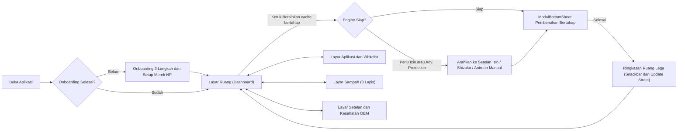

# UI/UX Design Specification — habNoir Clean (v2.0 Anti-AI-Slop Edition)

> **Dokumen:** UX-001 · **Versi:** 2.0.0 · **Identitas Produk:** **habNoir Clean** (`xyz.habnoir.clean`, Lisensi `GPL-3.0-or-later`)  
> **Standar Craft:** Menggabungkan estetika editorial [`Porto`](file:///c:/Users/Administrator/Documents/Coding%20Project/Porto) + disiplin *Anti-AI-Slop* (`impeccable` Android/Craft-Floor, `frontend-design`, `hallmark`, `ai-slop-cleaner`)  
> **Target Perangkat:** Android 12 (API 31) s.d. Android 17 (API 37) · Lebar layar `320dp` hingga Tablet/Foldable

---

## 1. Filosofi Visual, Identitas & Daftar Larangan Anti-AI-Slop

**habNoir Clean** hadir untuk pengguna kasual dan wanita Indonesia yang ruang penyimpanannya kerap penuh diam-diam oleh cache media sosial, belanja online, serta sampah galeri 30 hari—tanpa tampilan pembersih Android murahan yang penuh klaim virus palsu, lampu neon, atau istilah teknis mengintimidasi.

Berbeda dari antarmuka generik buatan AI (*AI Slop*), rancangan v2.0 ini mengikat setiap keputusan visual pada karakter asli [`Porto`](file:///c:/Users/Administrator/Documents/Coding%20Project/Porto) dan kaidah **native Android Material Design 3**:

### 1.1 Daftar Larangan Mutlak (*Strict Anti-AI-Slop Bans*)
Setiap elemen berikut **dilarang keras** muncul dalam kode Compose, resource string, maupun prototipe:
1. **Dilarang *Floating Pill Bottom Bar* gaya iOS** atau tombol/switch tiruan Cupertino; navigasi wajib memakai **Material 3 `NavigationBar`** (3 destinasi utama) yang menempel rapi di tepi bawah dengan pemisah `0.5dp` atas (dan `NavigationRail` pada layar `>= 600dp`).
2. **Dilarang *Eyebrow* ALL-CAPS berjarak lebar** di atas setiap judul (*mis. `SIAP DILEGAKAN`*). Judul dan angka utama berdiri sendiri tanpa label hiasan di atasnya.
3. **Dilarang tumpukan kartu identik (*card-inside-card* / *SaaS card grid*)**: Daftar aplikasi dan daftar pembersih sampah ditulis sebagai baris terbuka langsung di atas kanvas gelap yang dipisahkan garis *hairline* horizontal `0.5dp`, bukan ratusan kotak ber-border melingkar.
4. **Dilarang tipografi penanda template AI:**
   - Tidak ada tanda titik tengah (*middle dot* `·`) untuk menyambung kata pada header/chip UI;
   - Tidak ada tanda hubung panjang (*em-dash* `—`) pada label/subjudul UI;
   - Tidak ada panah (`→`) yang ditempelkan pada teks tombol;
   - Tidak ada penomoran dekoratif `01 / 02 / 03` pada hal yang bukan urutan langkah nyata.
5. **Dilarang ikon karakter Unicode (`✓`, `★`, `⚡`, emoji) dan ikon *sparkle***: Semua ikon harus berupa `ImageVector` stroke konsisten `1.5dp`.
6. **Dilarang pil status neon (`#86EFAC` hijau terang, kuning menyala, atau gradien ungu/biru generik):** Fokus visual dan jaminan keamanan disampaikan lewat hierarki warna editorial yang tenang dan tipografi jujur.
7. **Dilarang *Monospace* sebagai kostum label:** `Geist Mono` (`tnum`) hanya dipakai untuk **angka ukuran byte** (`2,85 GB`, `940 MB`) dan **rasio langkah nyata** (`8/34`).

---

## 2. Design System Tokens (`Porto` + Material 3 Role Mapping)

### 2.1 Palet Warna Editorial habNoir (Harmonis dengan Monogram `HN`)
Mengambil warna dasar gelap dari `Porto` (`#090A0F` & `#0F1117`) dan menyelaraskannya dengan warna **Warm Alabaster (`#F4F2EC`)** dari monogram `HN` pada [`logo-icon.png`](file:///c:/Users/Administrator/Documents/Coding%20Project/Android%20APP/assets/branding/logo-icon.png):

| Peran Material 3 / Token | Nilai Hex / Alpha | Fungsi di Layar |
| :--- | :--- | :--- |
| `background` (`ObsidianVoid`) | `#090A0F` | Kanvas utama seluruh layar & latar Adaptive Icon |
| `surfaceContainerLow` (`DockedBar`) | `#0B0C11` | `TopAppBar`, docked `NavigationBar`, latar bar bawah |
| `surfaceContainer` (`RaisedFolio`) | `#10121A` | `ModalBottomSheet` & permukaan kontras lembut |
| `surfaceContainerHigh` (`TonalFolio`) | `#171A24` | Container search bar, segmen kontrol aktif, dialog OS |
| `primary` (`WarmAlabaster`) | `#F4F2EC` | Tombol aksi utama, indikator aktif, teks penekanan tertinggi |
| `onPrimary` (`ObsidianInk`) | `#090A0F` | Teks dan ikon di atas tombol `WarmAlabaster` |
| `onSurface` (`AlabasterInk`) | `#F4F2EC` | Judul layar, angka hero `Cinzel`, nama aplikasi |
| `onSurfaceVariant` (`MutedSlate`) | `#A7AAB5` | Kalimat penjelas, label sekunder, ikon non-aktif |
| `outlineVariant` (`Hairline`) | `#F4F2EC` @ `9%` (`0.5dp`) | Garis pemisah horizontal antarbaris, tepi atas `NavigationBar` |
| `outline` (`ActiveHairline`) | `#F4F2EC` @ `22%` (`1dp`) | Fokus input cari, tombol outlined, border modal |
| `tertiary` (`WarmChampagne`) | `#E2C799` | Satu-satunya aksen hangat fungsional: gembok *Whitelist*, peringatan izin OEM, dan jeda *Thermal Guard* |
| `error` (`MutedClayRose`) | `#E08A8A` | Tombol `Hentikan`, indikasi ruang kritis `> 92%`, error izin |

### 2.2 Skala Tipografi Material 3 (`Cinzel` + `Geist Sans` + `Geist Mono`)

| Material Type Role | Font Family | Ukuran / Line Height | Tracking | Penggunaan Sah |
| :--- | :--- | :---: | :---: | :--- |
| `displayMedium` | `Cinzel` (`SemiBold`) | `42sp / 46sp` | `-0.02em` | Angka ruang siap dilegakan (`3,42 GB`) dan angka hasil akhir |
| `titleLarge` | `Cinzel` (`SemiBold`) | `20sp / 26sp` | `0em` | Nama merek `habNoir Clean` di `TopAppBar` & judul wizard |
| `headlineSmall` | `Geist Sans` (`SemiBold`) | `20sp / 26sp` | `-0.01em` | Judul halaman (`Aplikasi`, `Folder sampah`, `Setelan`) |
| `titleMedium` | `Geist Sans` (`Medium`) | `15sp / 20sp` | `0em` | Nama aplikasi di daftar, judul seksi sampah |
| `bodyMedium` | `Geist Sans` (`Regular`) | `14sp / 21sp` | `0em` | Copy empatik, panduan merek HP, teks jaminan |
| `labelLarge` | `Geist Sans` (`Medium`) | `14sp / 18sp` | `0em` | Label tombol aksi Material 3 |
| `labelMedium` | `Geist Sans` (`Medium`) | `12sp / 16sp` | `0.01em` | Label 3 tab `NavigationBar` & filter chip |
| `DataNumeric` | `Geist Mono` (`Medium`, `tnum`) | `13sp / 18sp` | `0em` | **Khusus** nilai byte (`940 MB`) dan progres batch (`8/34`) |

### 2.3 Spasi, Elevasi & Strategi Performa Surface
- **Grid Spasi:** `4dp` base, padding tepi layar `20dp` (`Compact`) dan `24dp` (`Medium/Expanded`), jarak antar-elemen kontrol minimal `8dp` dengan target sentuh minimum `48x48dp`.
- **Elevasi Tonal Tanpa *Ghost Card*:** Tidak mencampur bayangan tebal dan border secara bersamaan. Permukaan tingkat kedua memakai elevasi tonal (`#10121A` / `#171A24`) dan batas `0.5dp` `Hairline`. Blur shader (`RenderEffect`) hanya dipakai secara opsional pada `ModalBottomSheet` scrim di perangkat Tier A (`!isLowRamDevice`); kanvas daftar berjalan dengan **0 ms GPU blur overhead**.

---

## 3. Elemen Khas Produk: *The Calibrated Storage Strata*

Setiap halaman `Ruang` (Beranda) memiliki **satu titik fokus yang dirancang khas**—tidak memakai *centered metric card* generik maupun cincin donat AI:

1. **Komposisi Editorial Rata Kiri:** Angka ukuran `Cinzel` (`3,42 GB`) rata kiri di bagian atas area kerja, diikuti tepat satu kalimat ringkas Bahasa Indonesia: *"Cache dari 28 aplikasi dan sampah galeri 30 hari siap dibersihkan."*
2. **Bilah *Storage Strata Bar* (`10dp` tinggi, terkalibrasi nyata):**
   - Satu garis horizontal utuh yang dibagi menjadi tiga segmen proporsional berdasarkan data `StorageStatsManager` & `StatFs` perangkat:
     - **Pribadi & Sistem** (`#2A2F3D`) — porsi data tetap;
     - **Cache Aplikasi** (`#F4F2EC` *Warm Alabaster*) — porsi yang akan dilegakan tombol utama;
     - **Sampah Galeri** (`#E2C799` *Warm Champagne*) — porsi menunggu di tab Sampah.
   - Di bawah bilah tersaji tiga penanda angka `tnum` yang sejajar rapi dengan lebar proporsional tersebut (`Terpakai 114 GB` / `Cache 2,85 GB` / `Sampah 570 MB`).
3. **Aksi Tunggal Jernih:** Satu tombol penuh bergaya Material 3 *Filled Pill* berwarna `WarmAlabaster` (`#F4F2EC`, teks `#090A0F`, tinggi `52dp`): **`Bersihkan cache bertahap`**. Tepat di bawahnya satu baris teks tenang berwarna `MutedSlate` (`13sp`): *"Foto, chat, dan akun login tidak tersentuh."*
4. **Ledger Aplikasi Terboros (Tanpa Kotak Berulang):** Dipisahkan garis `0.5dp` tipis, daftar 5 aplikasi terbesar tampil langsung di atas kanvas gelap `#090A0F` tanpa bungkus kartu, dipisahkan garis horizontal `0.5dp` agar mata langsung menangkap nama app dan ukurannya.

---

## 4. Identitas Logo (`HN`) & Sistem Ikonografi

- **Adaptive Icon (`108x108dp`, safe zone `66x66dp`):** Mengkonversi monogram `HN` dari [`logo-icon.png`](file:///c:/Users/Administrator/Documents/Coding%20Project/Android%20APP/assets/branding/logo-icon.png) menjadi Vector Drawable XML (`< 3 KB`) berwarna `#F4F2EC` di atas kanvas `#090A0F`, plus `<monochrome>` drawable untuk *Themed Icons* Android 13–17.
- **Ikon Custom Stroke `1.5dp` (`24dp`):** Dibuat langsung sebagai `ImageVector` ringan tanpa membawa library `material-icons-extended`. Meliputi ikon navigasi (*Ruang*, *Aplikasi*, *Sampah*), *Setelan*, *Gembok Terbuka/Terkunci*, *Cari*, *Jeda/Lanjut/Hentikan*, *Perisai*, *Galeri*, dan *Kembali*.

---

## 5. Arsitektur Navigasi & Anatomi Layar (Material 3 Native)

### 5.1 Struktur Navigasi 3+1 yang Tenang
- **TopAppBar (`56dp`):** Kiri menampilkan emblem `HN` (`28dp`) + `habNoir Clean`. Kanan menampilkan satu chip merek HP ringkas (`Vivo`, `HyperOS`, `One UI`, dll.) yang dapat diketuk serta **ikon Setelan (`48x48dp`)** untuk membuka halaman *Setelan & Kesehatan OEM*.
- **Bottom `NavigationBar` M3 (`Compact < 600dp`) / `NavigationRail` (`>= 600dp`):**
  1. **Ruang** *(Beranda — pembersihan 1-klik & Storage Strata)*
  2. **Aplikasi** *(daftar seluruh cache & kunci Whitelist)*
  3. **Sampah** *(pembersih sampah 3-lapis: MediaStore 30 hari, folder tersembunyi, pintasan Galeri OEM)*
- **Halaman Sekunder (`Setelan & Kesehatan OEM` & `Onboarding Wizard`):** Mendukung *Predictive Back Gesture* Android 14–17 dan tombol panah kembali standar Material 3.

### 5.2 Anatomi Tiap Layar & Modal

| Layar / Komponen | Struktur Konten (Bebas Slop) | State Penting |
| :--- | :--- | :--- |
| **1. Ruang (Beranda)** | Banner izin kondisional (hanya muncul bila ada syarat belum aktif / Android 17 Adv. Protection) $\rightarrow$ Angka `Cinzel` + deskripsi singkat $\rightarrow$ *Storage Strata Bar* $\rightarrow$ Tombol **`Bersihkan cache bertahap`** + teks jaminan tenang (tetap *pinned* di atas) $\rightarrow$ Area daftar aplikasi terboros (`LazyColumn(Modifier.weight(1f))`) dengan **scroll sendiri** + tombol teks **`Lihat semua aplikasi`**. | *Siap Bersih*, *Memindai*, *Sudah Rapi* (tombol berubah ke **`Pindai ulang`**), *Izin Belum Lengkap*. |
| **2. Aplikasi** | `SearchBar` Material 3 (`imePadding()`) + baris chip filter tunggal (`Semua`, `Di atas 150 MB`, `Dikecualikan`) tetap *pinned* di atas $\rightarrow$ `LazyColumn(Modifier.weight(1f))` ledger baris aplikasi dengan **scroll sendiri** (`key = packageName`, garis pemisah `0.5dp`, gembok `WarmChampagne` `48x48dp` saat dikunci). | *Hasil Kosong Pencarian* dengan tombol `Hapus kata kunci`. |
| **3. Sampah** | 3 bagian editorial tanpa kartu bersarang, dipisah garis `0.5dp`: 1. **Sampah Galeri 30 Hari (`MediaStore`)**: jumlah file, ukuran MB, tombol **`Kosongkan permanen`** (chunk 150 URI). 2. **Folder Sampah Tersembunyi (`.Trash` / `.recycle`)**: path terverifikasi per merek HP + penjelasan batas izin opsional FOSS. 3. **Galeri Bawaan HP**: tombol **`Buka Galeri`** dengan panduan menu satu kalimat sesuai merek HP. | *Sudah Kosong* (tombol berubah status pasif informatif). |
| **4. Setelan & OEM** | Seksi 1: **Cara pembersihan** (*Otomatis via Aksesibilitas*, *Mode Shizuku*, *Antrean manual*). Seksi 2: **Batas minimum & pengingat** (pilih `1 MB / 5 MB / 10 MB`, info batch RAM saat ini, sakelar pengingat hemat baterai). Seksi 3: **Kesiapan merek HP** (checklist *Akses penggunaan*, *Aksesibilitas*, *Baterai tanpa pembatasan*, *Mulai otomatis* dengan tombol `Atur`). Seksi 4: **Privasi & lisensi** (`100% offline, tanpa izin internet`, `GPL-3.0-or-later`). | Status izin diverifikasi real-time setiap layar kembali aktif (`onResume`). |
| **5. `ModalBottomSheet` Pembersihan Bertahap** | Muncul saat **`Bersihkan cache bertahap`** ditekan: Indikator linear tipis di atas, label batch nyata (`Batch 2 dari 4`), nama aplikasi yang sedang diproses, ukuran terbebas `tnum`, baris status cooldown / *Thermal Guard* (`WarmChampagne`), serta tombol sejajar **`Jeda`** (`Outlined`) dan **`Hentikan`** (`MutedClayRose`). | *Membersihkan*, *Jeda Antar-Batch*, *HP Hangat (3 app/batch)*, *Dijeda Pengguna*, *Selesai* (angka `Cinzel` ruang lega + tombol **`Tutup`**). |
| **6. Onboarding (3 Langkah)** | Langkah 1: Komitmen offline & jaminan foto/chat aman. Langkah 2: Izin baca ukuran cache (*Usage Access*). Langkah 3: Panduan khusus merek HP yang terdeteksi + kotak panduan membuka **Setelan Terbatas (`⋮`)** untuk APK GitHub/F-Droid Android 13–17 (atau pilihan Mode Shizuku pada Android 17 Advanced Protection). | Dapat dibuka ulang kapan saja dari halaman Setelan. |

### 5.3 Glance Home Screen Widget (`P1`, Zero-Bitmap)
- **`2x1` Compact:** Latar `#10121A` radius `24dp` border `0.5dp`, ikon vektor `HN`, angka `Cinzel` (`3,42 GB`), tombol **`Bersihkan`** yang memicu `MainActivity` via `PendingIntent.FLAG_IMMUTABLE` (mematuhi aturan anti-`ForegroundServiceStartNotAllowedException` Android 17).
- **`4x2` Detail:** Tambahan label status singkat (*"28 aplikasi siap dibersihkan"*), tanpa bitmap besar (`< 20 KB` `RemoteViews`).

---

## 6. Peta Alur Pengguna

---

## 7. UX Writing Bank (Bahasa Indonesia Jernih, Suara Aktif, Anti-Slop)

Sesuai pedoman penulisan `frontend-design` dan `impeccable`: gunakan suara aktif, beri nama tombol sesuai tindakan nyatanya, pertahankan kata yang konsisten antara tombol dan `Snackbar`, serta nyatakan kesalahan secara jelas dengan solusi langsung tanpa basa-basi meminta maaf.

| Elemen | Teks Baku (`res/values-in/strings.xml`) |
| :--- | :--- |
| **Judul Hero Siap Bersih** | `Cache dari %1$d aplikasi dan sampah galeri 30 hari siap dibersihkan.` |
| **Judul Hero Sudah Bersih** | `Tidak ada cache di atas %1$s. Penyimpanan dalam kondisi lega.` |
| **Tombol Aksi Utama** | `Bersihkan cache bertahap` |
| **Jaminan Keamanan** | `Foto, chat, dan akun login tidak tersentuh.` |
| **Status Batch Normal** | `Membersihkan %1$s secara bertahap` |
| **Status Jeda Cooldown** | `Jeda %1$s detik sebelum batch berikutnya` |
| **Status Thermal Guard** | `Suhu perangkat meningkat. Jeda 5 detik dan batch diturunkan ke 3 aplikasi.` |
| **Dijeda Sentuhan User** | `Dihentikan sementara karena layar disentuh. Ketuk Lanjutkan untuk meneruskan.` |
| **Snackbar Selesai** | `%1$s ruang berhasil dilegakan dari %2$d aplikasi.` |
| **Snackbar Whitelist** | `%1$s dikecualikan dari pembersihan` / `%1$s dimasukkan ke daftar pembersihan` |
| **Error Izin Restricted Settings** | `Aksesibilitas terkunci oleh Setelan Terbatas. Buka Info Aplikasi, ketuk ikon titik tiga kanan atas, lalu pilih Izinkan setelan terbatas.` |
| **Info Android 17 Adv. Protection** | `Perlindungan Lanjutan Android 17 membatasi Aksesibilitas. Gunakan Mode Shizuku atau Antrean manual.` |
| **Tombol Layer 1 Sampah** | `Kosongkan permanen` |
| **Snackbar Sampah Kosong** | `%1$s sampah galeri 30 hari telah dihapus permanen.` |

---

## 8. Koreografi Motion & Haptic (60fps Low-RAM Safe)

- **Satu Momen Terarah, Bukan Efek Menyebar:** Tidak ada animasi *fade-and-slide-up* pada setiap baris daftar. Daftar aplikasi tampil seketika tanpa delay berjenjang.
- **Animasi Bernilai Fungsional:**
  - *Storage Strata Bar:* transisi halus lebar segmen (`320ms`, `FastOutSlowInEasing`) hanya ketika nilai byte berubah pasca-pembersihan atau saat mengunci Whitelist.
  - *Tombol Utama:* `Modifier.graphicsLayer { scaleX; scaleY }` `120ms` saat ditekan + haptic `Confirm`.
  - *Sheet Progres:* animasi standar Material 3 `ModalBottomSheet` (`250ms`).
- **Reduce Motion:** Membaca `ANIMATOR_DURATION_SCALE`; bila bernilai `0f`, seluruh durasi menjadi `0ms`.

---

## 9. Tata Letak Adaptif & Edge-to-Edge (API 31–37)

- **Compact (`< 600dp`, termasuk HP `320dp`):** `TopAppBar` + konten 1 kolom + `NavigationBar` M3 docked di bawah (`windowInsets` dikonsumsi tunggal lewat `Scaffold` `innerPadding` ke `contentPadding`). Di `320dp`, `displayMedium` menyesuaikan ke `34sp` agar angka GB tidak turun baris.
- **Medium (`600dp – 839dp`) & Expanded (`>= 840dp`):** `NavigationBar` otomatis diganti `NavigationRail` M3 di kiri; pada `Expanded`, kolom kiri (`45%`) menampilkan angka `Cinzel`, *Storage Strata Bar*, dan tombol aksi utama, sementara kolom kanan (`55%`) menampilkan ledger aplikasi terboros.
- **Kepatuhan Android 17:** Tidak mengunci orientasi layar di manifest; `android:windowSoftInputMode="adjustResize"`; `.imePadding()` aktif di layar pencarian `Aplikasi`.

---

## 10. Audit Aksesibilitas & Kontras WCAG

| Pasangan Warna | Rasio Kontras | Target WCAG |
| :--- | :---: | :---: |
| `#F4F2EC` (`WarmAlabaster`) di atas `#090A0F` (`ObsidianVoid`) | **~17.9 : 1** | **AAA** |
| `#A7AAB5` (`MutedSlate`) di atas `#090A0F` / `#10121A` | **~8.1 : 1** | **AAA** |
| `#090A0F` di atas `#F4F2EC` (Tombol utama) | **~17.9 : 1** | **AAA** |
| `#E2C799` (`WarmChampagne`) di atas `#10121A` | **~11.6 : 1** | **AAA** |
| `#E08A8A` (`MutedClayRose`) di atas `#10121A` | **~7.4 : 1** | **AAA** |
| `#747885` (`QuietInk`) di atas `#090A0F` *(metadata minor)* | **~4.6 : 1** | **AA** |

- **Target Sentuh & TalkBack:** Setiap tombol ikon (`Setelan`, `Gembok`, `Tutup`) berukuran minimum `48x48dp` dengan jarak `>= 8dp`. Setiap baris aplikasi memakai `Modifier.semantics(mergeDescendants = true)` agar TalkBack membacakan nama app, ukuran cache, dan status whitelist dalam satu kalimat utuh.
